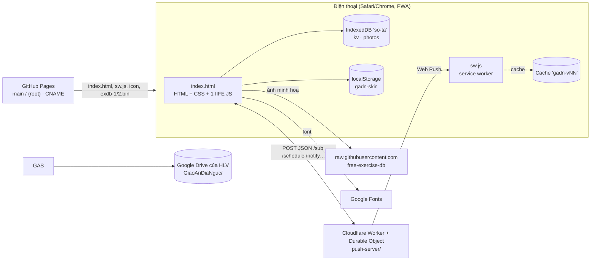

# SA tổng — Kiến trúc giải pháp Giáo Án Địa Ngục

> Mô tả cách app trên `main` sau PA-22 (+ PA-15: tài liệu, test, dọn mã chết) được xây dựng. Yêu cầu nghiệp vụ: [BR.md](BR.md). Điểm chưa ổn kỹ thuật: [VAN-DE-VA-CHIEN-LUOC.md](VAN-DE-VA-CHIEN-LUOC.md).
> Không ghi số dòng `index.html:nnnn` nữa (file đổi liên tục, ~5.300 dòng): tìm theo tên hàm/khối bằng `grep`.

## 1. Tổng quan



- **Không có backend của nhà phát triển.** Toàn bộ logic app chạy trên trình duyệt; dữ liệu ở IndexedDB của máy. Một máy chủ nhỏ **do HLV tự triển khai trên tài khoản Cloudflare của mình** (không bắt buộc): `push-server/` (đồng bộ HLV ⇄ học viên và thông báo đẩy, §7.6–§7.8). Không còn đồng bộ tài khoản Claude (đã bỏ, PA-41; §6, §10).
- **Phân phối**: GitHub Pages dựng từ `main` / `(root)`; tên miền riêng qua `CNAME`. Bản xem thử một nhánh: `https://raw.githack.com/hoangtourguide0507-create/giao-an-dia-nguc/<nhánh>/index.html`.
- **Không có bước build.** Sửa `index.html` là phát hành; tăng `CACHE` trong `sw.js` để máy người dùng nhận bản mới.

### Thành phần file

| File | Vai trò |
|---|---|
| `index.html` | Toàn bộ app (~5.340 dòng): `<style>` (2 giao diện `amber`/`gold`), HTML khung (header + chuông, `#view`, thanh nghỉ, thanh dưới `#nav-bar`, bảng `#sheet`, hộp báo `#alarm`, `#toast`), 2 thư viện nhúng (qrcode-generator 1.4.4 MIT, jsQR 1.4.0 Apache-2.0), script chính (IIFE `'use strict'`, thẻ `<script>` lớn nhất) |
| `sw.js` | Service worker: cache vỏ app, network-first cho trang, cache-first cho tài nguyên, font; hiện thông báo đẩy và mở lại app khi bấm thông báo |
| `push-server/` (`src/index.js`, `wrangler.toml`, `HUONG-DAN.md`) | Máy chủ Web Push trên Cloudflare Workers (§7.6) |
| `thiet-ke/pa22-mockup.html` | Bản mockup thiết kế PA-22 (tham khảo, không phát hành vào app) |
| `.claude/agents/*.md` | Các agent làm việc của dự án (duyệt PA, kiểm chứng y khoa, kiểm thử, máy chủ, triển khai PA, UX/UI) |
| `manifest.webmanifest`, `icon-*.png`, `apple-touch-icon.png` | PWA |
| `exdb-1.bin`, `exdb-2.bin` | 2 gói hình minh hoạ offline (định dạng GAP1, §9) |
| `package.json`, `playwright.config.mjs`, `scripts/`, `tests/` | Bộ kiểm thử (§12), không phát hành cho người dùng |

## 2. Cấu trúc script chính

Script chính là một IIFE, chia thành các khối (tiêu đề `/* ---------- … ---------- */`):

| Khối | Vị trí | Nội dung chính |
|---|---|---|
| Tiện ích | đầu script | `$`, `$$`, `esc` (chống chèn HTML), `uid`, ngày `ymd/parseYmd/addDays/dm`, `num` (đọc số có dấu phẩy), `fmt` (vi-VN), `e1rm` (Epley), bộ icon theo skin, `renderNav` |
| Dữ liệu nền | sau tiện ích | `MUSCLES` (13 nhóm), `TYPES` (lower/upper/iso, nấc mặc định), `REST_MODES`, `TEMPOS`, ước lượng thời gian (`exEst`, `dayEst`, `remainEst`), `PAIN_AREAS/PAIN_LV`, `PACE`, thư viện bài `LIB2` (tên, vùng cơ, kiểu, mã hình, nhóm), `SAMPLE`, `METRICS`, `newEx`, `migrateEx` |
| Lưu trữ | `LDB` | `LDB` (IndexedDB + bộ nhớ dự phòng; ảnh chỉ trên máy), `switchProfile`, `freshState`, `loadState` (chuyển đổi dữ liệu cũ), `save` (trễ 300 ms) / `flush` |
| Truy vấn | sau `loadState` | `findDay/findEx/slotOf`, `exHistory`, `wt`, `bestE1`, `volOf`, `roundStep`, `baseKg`, `manualOverride`, xoay vòng `rotDue/rotPick/swapMain` |
| Chu kỳ & gợi ý | `cycleInfo`… | `cycleInfo` (tự dời `cycleStart` khi đã hết tuần deload, PA-28), `isDeload`, `suggestBase/suggestLinear/suggestDouble/suggestP/suggest`, `roadmap` |
| Giao diện chung | `ui`, `SKINS` | `ui` (trạng thái giao diện, không lưu), `SKINS` (`amber`, `gold`), `applySkin`, `NAV` + `renderNav`, `render`, hiệu ứng (`countUp`, `prSlam`), kéo để làm mới, `renderHeader` |
| Hồi phục & gợi ý buổi | `muscleLoad`… | `muscleLoad`, `readiness`, `rdState`, `recommend`, `dayWhy`, banner |
| Trang chủ & buổi tập | khối `viewHome`, `viewSession` | `viewHome` (thẻ vé buổi gợi ý `.hero.tix`, chip ngày `.dchip`, hai thẻ nhỏ `.g2`, `todoItems/todosHtml`, độ hồi phục), `startPickSheet` (nút Tập), `viewSession`, `entryCard/entryMini`, khởi động, drop set, `makeEntry`, `startSession`, vùng cơ (`ZONES`, `guessZone`), hướng dẫn (`guideSheet`, `bodyMap`, `CUES`), thư viện hình offline |
| Đồng hồ nghỉ & thông báo | khối `startRest` | `startRest/tickRest/stopRest`, `notifyRestEnd` (Notification API), `schedulePush/cancelPush` (hẹn giờ trên máy chủ thông báo), âm thanh WebAudio, rung, Wake Lock, `finishSummary`, `saveSession`, `reopenSession`; Web Push: `pushRegister`, `pushRules`, `pushNotify`, `drvTopic(s)`, `notifCardHtml` |
| Tab Lịch tập | khối `viewPlan` | `viewPlan` (biểu đồ nhỏ `svg.spk` trên thẻ bài khi ≥ 2 buổi), các bảng sửa bài/ngày/kho bài/tạ đơn/xoay vòng, nén ảnh `compressImage`, `hydratePhotos` |
| Tab Tiến độ | khối `viewWeek` | `periodStats`, `progTabs` (Sức mạnh / Cơ thể / Ảnh), `tonTix`, `viewWeek`, `progressSheet`, `sessionSheet`, biểu đồ SVG `drawLine` |
| Cơ thể & ảnh | khối `viewBody` | `bRange`, `bodyVerdict`, `viewBody`, ảnh trước/sau, đọc EXIF (hiển thị trong Tiến độ) |
| Tab Tài khoản | khối `viewMore` | `viewMore` (thẻ hồ sơ + khối Đăng nhập hoặc khối máy chủ (`loginCardHtml` / `hubCardHtml`) + mục Học viên có thẻ QR (`hlvStudentsHtml`) + danh mục `row()` → trang con `SEC[...]`: backup, pack, pace, form, height, notif, skin, install, wipe) |
| Người tập & HLV | khối `profStats` | `profStats`, `withState`, `coachData/coachRich`, `viewTeam` (Phòng HLV, đầu Trang chủ của HLV), `studentsOf`, kế hoạch tuần (`wpBuild`, `weekPlanSheet`), các bảng hồ sơ |
| Đồng bộ, Drive, tài khoản | khối `DRV` … `acc*` | Động cơ gộp dùng chung (`syncPack`, `cleanPkg`, `syncMerge`, `syncApply`, `syncUndo`, `syncReceive` cho file `gadn-sync`); Drive: `DRV`, `drvCall`, `drvSyncOne`, `drvEnsureAll`, `drvAuto/drvSoon`, ảnh (`drvLocalPhotos/drvPushPhotos/drvPullPhotos`), mã liên kết `drvCode/drvLinkReceive`; tài khoản: `accCardHtml`, `accApply`, `accRoster`, `accTvSheet/accTvForm`, `accHet`; QR: `qrScanSheet`, `decodeQrImage`, `joinQrParts`, `handleCodeText`, `oldCode`, `copyOrShareCode`; khôi phục file 1 người |
| File, sheet, toast | cuối khối đồng bộ | `saveFile` (claude.ai downloads hoặc `<a download>`), `openSheet/closeSheet/confirmSheet`, `toast` |
| Sự kiện | khối `handlers` | Bảng `handlers` (~186 hành động), ủy quyền `click` theo `data-act`, `input` theo `data-bind`, `change` (file, checkbox), `keydown` Esc, `visibilitychange`, `pagehide`, `beforeinstallprompt`, đồng hồ 1 giây |
| Khởi động | cuối script | Mở IndexedDB → nạp hồ sơ + trạng thái → `render` → đọc trạng thái gói hình → `hubSync` sau 1,6 s → `pushRegSoon` → tự mở kế hoạch tuần → đăng ký service worker (chỉ https) |

`window.__sota` lộ một số hàm thuần (`suggest`, `roadmap`, `exHistory`, `baseKg`, `warmSets`, `recommend`, `muscleLoad`, `switchProfile`, `findEx`, `slotOf`, `autoGid`, `guideSheet`, `exdbMatch`) và getter `state/ui/profiles` để gỡ lỗi và kiểm thử.

### Mô hình hiển thị
- `render()` vẽ lại toàn bộ `#view` bằng chuỗi HTML theo `ui.tab` (`viewHome`/`viewSession` — `viewToday` chọn một trong hai —, `viewPlan`, `viewWeek` (kèm Cơ thể/Ảnh qua `progTabs`), `viewMore`); vai máy `isHlv()` = `hubRole() === 'hlv'` (BR-25); trong buổi tập dùng `refreshExCard(i)` để chỉ thay một thẻ bài (giữ con trỏ ô ghi chú).
- Mọi nút có `data-act="<tên>"` → `handlers[<tên>](element, event)`. Ô nhập có `data-bind` (`set`, `note`, `setting`, `cmp`).
- Bảng nổi (`openSheet(html)`) dùng cho mọi form/hộp thoại; `confirmSheet` cho xác nhận nguy hiểm (`pendingConfirm`).
- Mọi chuỗi người dùng nhập được `esc()` trước khi chèn vào HTML.

## 3. Mô hình dữ liệu

### 3.1 Nơi lưu

| Nơi | Khoá | Giá trị |
|---|---|---|
| IndexedDB `so-ta` v1, store `kv` | `profiles` | `{ active, list: [{ id, name, color, goal? }] }`; trường cũ `coach` (chế độ HLV, PA-38) được bỏ một lần khi mở app (mig30) |
| | `state` (hồ sơ `p1`), `state:<pid>` | Trạng thái một hồ sơ (§3.2) |
| | `exdbPack` | `{ n, at }` — đã tải thư viện hình |
| | `drvUp:<link máy chủ>` | Danh sách mã băm ảnh đã đẩy lên Drive (≤ 3.000) |
| | `pushRegH` | Băm lần đăng ký thông báo gần nhất (tránh đăng ký lặp) |
| | ~~`syncUndo`~~, `undo`, `prevDays` | Đã bỏ (PA-41), dọn khi khởi động |
| IndexedDB store `photos` | `<uid>` | Ảnh máy tập / ảnh body: data URL JPEG nén |
| | `exdb:<gid>:<0\|1>` | Hình minh hoạ (JPEG nén từ GitHub, hoặc WebP từ gói offline) |
| | `vid:<uid>` | Video của tôi (Blob). Dọn bằng `vidIdsOf` khi xoá hồ sơ/ngày/bài; "Xoá toàn bộ dữ liệu" xoá mọi khoá trừ `exdb:*` (PA-28) |
| localStorage | `gadn-skin` | Giao diện đang dùng `amber`/`gold` (để tô màu trước khi IndexedDB mở) |
| | `data/users/<uid>/app` (p1) · `app-<pid>` | Trạng thái hồ sơ trừ `sessions` |
| | `…/sessions/<id>` · `…/photos/<id>` | Từng buổi tập · từng ảnh `{ d }` |

### 3.2 Trạng thái một hồ sơ (`v: 3`)

```js
{
  v: 3, updatedAt,                       // ms, đặt mỗi lần save()
  days: [Day], sessions: [Session], active: Session|null,
  body: [{ id, date, weight?, bodyFat?, muscle?, waist?, visceral?, restHR?, hrv?, ... }],
  bodyPhotos: [{ id, date, t, pose: 'Trước'|'Nghiêng'|'Sau', photoId }],
  pains: [{ id, area, level: 1|2|3, since, note, resolvedAt }],
  weekPlans: { 'YYYY-MM-DD(thứ Hai)': { mode: 'balanced'|'focus'|'deload', focus, dec: {exId: 'ok'|'hold'|'custom'}, custom: {exId: kg}, kg: {exId: kg}, at } },
  wpSkip: 'YYYY-MM-DD',                  // tuần đã bấm "Để sau"
  coachLink: { pk, name },               // (cũ) liên kết HLV kiểu mã; Drive dùng `drv`
  drv: { id, m, u, n, hvSeen, hlvSeen, hvRev, hlvRev, sentH, at, nP, nS, restore }, // liên kết Drive của hồ sơ (§7.2)
  syncMark: { sent: {sessionId: rev}, planH, at }, syncDel: { s: {id: t}, e: {key: t} },
  settings: { name, height, sex, setMin: 10, setMax: 20, deloadEvery: 6, cycleStart, progMode: 'linear'|'double',
              pace: 'std'|'slow', restMode, tempo, formCues, skin: 'amber'|'gold', skin22, mig29, notify, sfx, haptics, eff, fxOff, animOff,
              acc: { vai: 'hlv'|'hv', u, ten, hlv? },          // tài khoản đăng nhập (§7.3)
              drvUrl, drvKey, drvSv,                           // máy HLV: link máy chủ + MÃ HLV; drvSv = link nhớ ở màn đăng nhập
              pushServer, nRemind, nDays[], nTime, nWeekly, nDrive,   // thông báo (§7.6)
              lastBackupAt, lastBackupSess, backupSkipAt, packSkip, sets3, warmAll,
              /* còn trong dữ liệu nhưng không dùng: */ schedule, remindTime, remindBefore, restAlert, alertMethod, ntfyTopic, pushKey, shortcutName, alertV17 }
}
```

- **Cài đặt dùng chung}
```

- **Cài đặt dùng chung mọi hồ sơ** (`GLOBAL_KEYS`): giao diện, âm thanh/rung/hiệu ứng, thông báo (`notify, pushServer, nRemind, nDays, nTime, nWeekly, nDrive`), Drive/tài khoản (`drvUrl, drvKey, drvSv, acc`), sao lưu (`lastBackupAt, lastBackupSess, backupSkipAt`) và các khoá cũ (`alertMethod, ntfyTopic, pushKey, restAlert, shortcutName, alertV17`) — được chép từ hồ sơ cũ sang hồ sơ mới khi chuyển người / nạp từ tài khoản / khôi phục.
- **Day** `{ id, name, exercises: [Exercise], sample? }`.
- **Exercise** (bài chính) `{ id, name, muscle, zone, type, sets, repTarget, repMin, repMax, dropSet, step, rest, restV: 2, setup, photos[], currentKg, targetKg, kgSetAt, warmup, each, gid, cues, vid, vlink, slot, mainSince, alts: [Exercise không có alts/slot/mainSince], srcId?, alias?, fromStudent? }`. `rest = 0` = tự động theo nhịp nghỉ. `kgSetAt` ≠ null nghĩa là mức tạ được nhập tay (ưu tiên hơn lịch sử cũ hơn).
- **Session** `{ id, dayId ('custom'|'qr'|'sync'|day.id), dayName, date, startedAt, finishedAt, paused, deload, est, focus, reopened, entries: [Entry], syncFrom?, fromQR? }`.
- **Entry** `{ exId, name, muscle, note, each, sets: [{ kg, reps, dr?: 1..3, ef?: 'e'|'m'|'h'|'f' }], drop: {kg, reps}|null /* kiểu cũ */ }`. Trong buổi đang tập set còn có `done`, `m` (set drop đã tự sửa) và `entry.warm[]`, `entry.manual`.

### 3.3 Chuyển đổi dữ liệu cũ (`loadState`, `migrateEx`, `index.html:1798`)
Gộp với `freshState()`; bổ sung trường thiếu; `rest === OLD_REST[type]` → 0; `sets3` (mọi bài 3 set, 1 lần), `warmAll` (bật khởi động, 1 lần); `alertV17`/`alertMethod` cũ → thông báo của app (bỏ Phím tắt); giao diện: skin lạ → `amber`; chưa có cờ `skin22` và hồ sơ đã có giáo án/buổi tập (dữ liệu cũ) → `amber`; hồ sơ trống giữ lựa chọn; luôn đặt `skin22` (VD-32 đã sửa, PA-26). `deloadBanner` chịu được `cycleInfo()` null (VD-31, PA-26); mảng/đối tượng hỏng → rỗng; `mainSince` = ngày buổi đầu có bài; sau mỗi `render` còn `fillZones` (đoán vùng cơ, sửa nhóm "Khác") và `fillGids` (đoán hình minh hoạ). Test: `tests/app/misc.spec.mjs`.
Gộp với `freshState()`; bổ sung trường thiếu; `rest === OLD_REST[type]` → 0; `sets3` (mọi bài 3 set, 1 lần), `warmAll` (bật khởi động, 1 lần); `mig29` (PA-29: `pace: 'slow'` → `'std'`, `progMode: 'double'` → `'linear'`, đặt cờ; cũng chạy trong `normState` nên gói đồng bộ cũ không mang lại giá trị cũ); `alertV17`/`alertMethod` cũ → thông báo của app (bỏ Phím tắt); giao diện: nếu chưa có cờ `skin22` hoặc skin lạ → `amber` rồi đặt `skin22` (nguồn gốc VD-32); mảng/đối tượng hỏng → rỗng; `mainSince` = ngày buổi đầu có bài; sau mỗi `render` còn `fillZones` (đoán vùng cơ, sửa nhóm "Khác") và `fillGids` (đoán hình minh hoạ). Test: `tests/app/misc.spec.mjs`.

## 4. Thuật toán

### 4.1 Gợi ý mức tạ (`suggest`, `index.html:1868–1955`)
```
suggest(ex) = áp kế hoạch tuần đã duyệt( thêm "kg/tay"( suggestP(ex) ) )
suggestP    = điều chỉnh theo đau( suggestBase(ex) )   (tuần deload + đau: tính 80% trên `base` = mức gốc W, không trên 90% — PA-29)
suggestBase = chưa có lịch sử hoặc mức tự nhập mới hơn → start/new
              tuần deload → 90% W
              progMode 'double' → suggestDouble, ngược lại suggestLinear
```
- Lịch sử = `exHistory(ex.id)` bỏ buổi `deload`, mới nhất trước; `W = max kg` buổi gần nhất.
- Linear: điều kiện "đạt", "hỏng" (`ef === 'f'`), "dễ" (mọi set `ef === 'e'`), cổng 6 ngày tính từ buổi đầu tiên liên tiếp ở W (`gate = first.date + 6`), `need` theo `PACE`. Giảm: `roundStep(W*0.9)` hoặc `W − step`.
- Đau: `low = floor(kg × 0,8 / step) × step`. Kế hoạch tuần: thay `kg` bằng `weekPlans[thứ Hai].kg[exId]`, nhãn theo `dec`.
- `roundStep(v, step) = max(0, round(v/step) × step)` (2 chữ số thập phân).

### 4.2 Lộ trình (`roadmap`) — mô phỏng tối đa 156 tuần từ mức hiện tại: tuần không deload tăng `streak`, đủ `need` thì +1 nấc; tuần deload `(w0 + i − 1) % (every + 1) + 1 === every + 1` lấy 90%; dừng khi đủ số tuần hiển thị và đã đạt mục tiêu.

### 4.3 Khởi động, drop set
- `warmSets(ex, W, kind)` (§BR-03.6), loại trùng và loại ≥ W; dự phòng 1 set.
- `dropKgs(ex, base)`: 80/65/50% làm tròn theo nấc, mỗi set < set trước ít nhất 1 nấc; `syncDrops` tính lại set drop chưa tập, chưa sửa (`m`).

### 4.4 Hồi phục & gợi ý buổi
- `muscleLoad()`: thời điểm gần nhất mỗi nhóm cơ có ≥ 2 set (gồm drop). `readiness = min(1, giờ đã qua / (72|48))`.
- `recommend()`: với mỗi ngày tập, trọng số theo số set mỗi nhóm cơ: `score = 0,6·rd + 0,25·need + 0,15·stale − 0,5·[rd<0,66] − 0,6·pf` (need = phần set còn thiếu so với `setMin` của tuần, stale = min(1, ngày từ lần cuối/7), pf = tỉ lệ set của bài đang đau mức ≥ 2).
- Nhóm cơ chính của ngày (`dayRd`) = nhóm chiếm ≥ 30% số set.

### 4.5 Khác
- Thời gian dự kiến: `setSec(r) = r × tempo + 5`; `SWITCH_SEC 60`, `WARM_SEC 170`, `FEEL_SEC 60` (§BR-06.7). Còn lại trong buổi: `remainEst`.
- Khối lượng: `Σ kg × rep` (+ drop), × 2 nếu tạ đơn ghi mỗi tay. Kỷ lục: `bestE1 > max lịch sử + 0,01`.
- Cơ thể: `fatKg = weight × bodyFat/100`, `leanKg = weight − fatKg`; mốc so sánh `refOf` = lần đo cuối của tháng trước, không có thì lần đầu; ngưỡng 0,3 kg.
- Vùng cơ: `ZONES` (12 nhóm lớn → vùng), `ZRULES` (regex theo tên tiếng Việt/Anh), `LIBZ` từ thư viện.
- Tìm hình minh hoạ: `exdbMatch` dịch từ khoá Việt → Anh (`VI_EN`), so khớp token với 870+ bài Free Exercise DB (`EXDB` nhúng); tự gán khi điểm ≥ 0,75.

## 5. Luồng buổi tập

```mermaid
stateDiagram-v2
  [*] --> ChuaTap: không có state.active
  ChuaTap --> DangTap: startSession(day | exIds) → state.active
  DangTap --> DangTap: set-done → startRest(); step/input → save(); add/rm/swap entry
  DangTap --> TongKet: finish → finishSummary()
  TongKet --> DangTap: Tập tiếp
  TongKet --> DaLuu: saveSession() → sessions.push, currentKg, cycleStart
  DangTap --> ChuaTap: cancel / discardSession
  DaLuu --> DangTap: reopenSession (trong ngày hoặc ≤ 6 giờ)
```


- `syncActive()` giữ buổi đang tập khớp giáo án khi sửa giáo án (thay bài chính đổi, bỏ bài đã xoá chưa tập, thêm bài mới, sắp lại thứ tự; nhóm ưu tiên lên đầu).
- Đồng hồ nghỉ: `rest.end` (ms) + `setInterval(250ms)`; hết giờ khi trang ẩn thì đặt `rest.pending`, `visibilitychange` hiện hộp báo. Lúc bắt đầu nghỉ gọi `schedulePush` (hẹn giờ trên máy chủ thông báo nếu có), hết giờ khi trang ẩn gọi `notifyRestEnd` (§7.6).

## 6. Lưu trữ (chỉ trên máy)

Đồng bộ tài khoản Claude (`Cloud`, `reconcile`, `connectCloud`, `syncCardHtml`) đã gỡ hoàn toàn (PA-41, BR-18 đã bỏ). Dữ liệu và ảnh chỉ nằm trong IndexedDB của máy; `DB` đã thay bằng `LDB`.

- `save()` đặt `updatedAt`, ghi IndexedDB sau 300 ms (`flush`). Trang ẩn/`pagehide` → ghi ngay.
- Đồng bộ với máy chủ Cloudflare `push-server/` (§7.8) chạy tự động qua `hubSync()` (BR-24.21): khi nối máy/đăng ký, khi mở app, khi có mạng, mỗi 20 giây khi app hiện; `save()` gọi `hubFlushSoon`/`hubPlanSoon` khi dữ liệu đổi.
- **Quy tắc xung đột**: buổi tập tự gộp (bản mới hơn thắng, buổi trùng giữ cả hai) và không hỏi; giáo án chỉ hỏi khi cả hai bên cùng đổi so với lần thống nhất trước (BR-24.18, BR-24.23).

## 7. Đồng bộ qua Google Drive, tài khoản, thông báo

### 7.1–7.3 Google Drive và Apps Script (ĐÃ BỎ, PA-35)
Máy chủ Apps Script (`drive/Code.gs`), liên kết `GAL1`, tài khoản tên + mật khẩu và đồng bộ qua thư mục Drive đã gỡ hoàn toàn khỏi app và repo. Dữ liệu trên máy đã có được giữ nguyên; máy chủ thay thế là `push-server/` (xem §7.7 và §7.8).
Động cơ gộp `syncPack`/`syncMerge`/`cleanPkg` vẫn dùng cho giáo án và buổi tập (§7.4).

### 7.4 Gói đồng bộ và động cơ gộp (dùng chung cho Drive và file)
- Gói đầy đủ (`syncPack`): `{ app:'gadn-sync', v, role:'coach'|'student', link:{pk, cn}, name, at, plan|null, sessions[], del:{s,e}, photos? }`. Khoá nhận diện bài dùng chung giữa máy: `shKey(id) = '~' + 5 ký tự FNV-1a`, `canonKey = shKey(srcId || id)`, `exKeys` gồm cả `alias`.
- Nhận: `cleanPkg` giới hạn mọi trường (≤ 2.000 buổi, ≤ 60 bài/buổi, ≤ 30 set, ảnh chỉ nhận data URL jpeg/png/webp < 1,5 MB, ≤ 300 ảnh) → `syncMerge(L0, P, choices)` chạy trên **bản sao**, trả báo cáo `R` → Drive ghi thẳng; file thủ công xem trước rồi `syncApply` (ghi + lưu `syncUndo`).
- `syncMerge`: (1) gộp dấu xoá; (2) giáo án — máy HLV giữ cấu trúc, nhận mức tạ (`kgSetAt` mới hơn), ảnh (theo băm nội dung), bài `fs` (học viên tự thêm); máy học viên dựng lại theo HLV, khớp bài theo khoá rồi theo tên (ghi `alias`), bỏ bài HLV đã bỏ; (3) buổi tập theo id, so `rev = finishedAt||startedAt`, xử lý buổi trùng; (4) mức tạ theo buổi mới nhất; (5) cập nhật `syncMark`, `coachLink`.
- Đã xoá khỏi mã (PA-19 + dọn PA-15): mã giáo án `SOTA1/SOTA2`, mã gọn `GAS1/GAS2`, `GAQ1`, `GAP2`; các kiểu này chỉ còn được **nhận diện** để báo `oldCode()`. File `gadn-sync` vẫn nhận qua *Khôi phục từ file* (`restore-file` → `syncReceive`).

### 7.5 QR & ảnh mã
- Vẽ: `qrcode(0, 'L')` lên canvas (mã liên kết `GAL1` của HLV); ảnh mã: canvas trắng, tiêu đề + hướng dẫn, các mã xếp dọc → PNG.
- Đọc camera: `getUserMedia` (camera sau, 1920×1080), cắt vùng giữa 85%, luân phiên 960/480 px, `jsQR` mỗi 90 ms, gom trang theo `id`; mã lạ (không phải mã app) → tiếp tục chờ.
- Đọc ảnh: thử cả ảnh, rồi trượt khung vuông bằng chiều ngang ảnh từ trên xuống (bước 6%), `inversionAttempts: 'attemptBoth'`.

### 7.6 Thông báo
- **Cục bộ**: `notifyRestEnd` khi hết giờ nghỉ mà trang ẩn: `serviceWorker.getRegistration().showNotification` (dự phòng `new Notification`), `tag:'rest'`. Xin quyền ở `notif-allow`.
- **Web Push qua `push-server/`** (Cloudflare Worker + Durable Object `Hub`, SQLite): khoá VAPID tự sinh lần chạy đầu. API JSON: `GET /vapid`; `POST /sub {sub, topics, tzOff}`, `/schedule {sub, at, title, body, tag}`, `/cancel {sub, tag}`, `/remind {sub, rules[{dow, hm, title, body, tag}], tzOff}`, `/notify {topic, title, body, tag, from}`, `/test {sub}`. Giới hạn 3.000 máy, 20 luật nhắc, 200 chủ đề mỗi máy.
- Địa chỉ máy chủ: `pushBase() = settings.pushServer || PUSH_SERVER` (`PUSH_SERVER` dựng sẵn từ PA-23). Khi khởi động, nếu đã bật `notify`, chưa có đăng ký đẩy, có máy chủ và quyền = granted thì `enablePush()` tự nối; `notif-allow` cũng gọi `enablePush()` ngay sau khi được cấp quyền.
- App: `pushRegister` (đăng ký `PushManager` bằng khoá VAPID, gửi `/sub` + `/remind`; băm `pushRegH` tránh lặp; gọi lại sau khi đổi cài đặt/đăng nhập) · `schedulePush/cancelPush` (giờ nghỉ) · `pushNotify` khi giáo án HLV đổi hoặc học viên tập xong · **chủ đề** `drvTopic = SHA-256(mã:id:phía)[:32]` nên chỉ hai máy cùng liên kết nhận được tin của nhau.
- `sw.js` hiện thông báo trong sự kiện `push` và mở/focus app ở `notificationclick`.

### 7.7 Máy chủ đồng bộ `/s/*` (PA-33 · chưa dùng trong app)
- Mã: `push-server/src/sync.js`, gắn vào `Hub.fetch` qua tiền tố `/s/`. Dữ liệu: SQLite của Durable Object (`tv`, `tb`, `rec`, `meta`). Chi tiết thiết kế và BR: [epics/2026-10-22.md](epics/2026-10-22.md), hạng mục 4.
- Xác thực: `Bearer h.<khoá HLV>` (băm phải khớp secret `HLV_HASH`) hoặc `Bearer v.<mã HV>.<khoá máy>`. Không có lệnh tạo HLV. Khoá HV và khoá máy chỉ lưu dạng băm SHA-256.
- Học viên: `tv.kieu = 'hv'` (nối bằng QR, tối đa 5 máy, đổi mã thu hồi mọi máy, khoá chặn ngay). Hồ sơ sao lưu của HLV: `kieu = 'sl'`, lưu với khoá `sl:<mã>`, không lẫn vào danh sách học viên và không bao giờ báo.
- Bản ghi `rec(hv, k, id, seq, t, vai, xoa, d)`: `k` là `buoi:<id>` (cả hai phía), `plan@hlv` (chỉ HLV), `plan@hv` (chỉ học viên). `seq` tăng toàn phòng; bản cũ hơn (`t` nhỏ hơn) bị từ chối và trả lại bản hiện có. Giới hạn: buổi 256 KB, giáo án 1 MB, 200 bản ghi/lần.
- Thông báo: `ev` chỉ báo khi bản ghi mới thật, không có `backfill`, không phải `sl:`. Buổi mới → máy HLV (`who = 'hlv'`); giáo án mới → máy của học viên (`who = 'hv:<mã>'`).
- **Passkey (PA-33b)**: `POST /s/pk/thach` cấp thách thức dùng một lần (hết hạn 5 phút). `POST /s/pk/dky` (máy HV) lưu khoá công khai, kiểm `type = webauthn.create`, `challenge`, `origin`. `POST /s/pk/vao` (không cần khoá máy) kiểm `type = webauthn.get`, `origin`, `rpIdHash`, cờ UP và UV, chữ ký ECDSA P-256 (DER → r‖s) rồi cấp khoá máy mới. Mặc định `RP_ID = gym.fiddle.vn`, `RP_ORIGIN = https://gym.fiddle.vn` (ghi đè bằng biến môi trường). Tối đa 5 khoá/học viên.
- **Ảnh máy tập (PA-33b)**: `POST /s/anh/co` hỏi ảnh còn thiếu; `PUT /s/anh/<tên>?hv=` và `GET /s/anh/<tên>?hv=`. Tên ảnh `[A-Za-z0-9_-]{4,64}` (mã băm PA-25). Tối đa 1,2 MB/ảnh (base64 vẫn dưới giới hạn 2 MB của một dòng SQLite). Hạn mức 400 MB/học viên và 4 GB/phòng (`IMG_QUOTA_HV`, `IMG_QUOTA_ROOM` ghi đè được); vượt thì 507, nhưng chữ (`/s/ghi`) vẫn nhận. Ghi đè ảnh cùng tên không cộng dồn.
- Chưa có WebSocket theo quyết định của anh (dùng Web Push và hỏi `/s/doi` định kỳ).
- **Quản trị giáo án (PA-46 D1, chỉ đọc)**: `push-server/src/admin.js`, đường `GET /s/admin/giao-an[?d=1]`, xác thực `Authorization: Bearer a.<ADMIN_KEY>` so băm SHA-256 với secret `ADMIN_HASH`; chưa đặt secret thì tắt (401). Trả báo cáo bài trùng của mọi `plan@hlv`/`plan@hv` (kể cả `sl:`); `d=1` kèm nội dung gốc để sao lưu. Hàm thuần `push-server/src/dedupe.js` (`baoCaoTrung`, `dedupePlan`, BR-33.2): trong một ngày, bài trùng khi khoá `i` giao nhau hoặc cùng tên; giữ bài mức tạ cao hơn → `kgSetAt` mới hơn → có ảnh/ghi chú, gộp khoá `i`. D1 không ghi dữ liệu. Test: `tests/test_dedupe_plan.mjs`, mục 12 của `tests/test_hub_sync.mjs`.
- Kiểm thử: `tests/test_hub_sync.mjs` (49 kiểm tra, PA-33) và `tests/test_hub_pa33b.mjs` (34 kiểm tra: passkey gồm chữ ký thật do khoá P-256 giả lập ký theo DER, ảnh, hạn mức), đều chạy đúng `push-server/src/index.js` với SQLite thật (`node:sqlite`), được gọi trong `bash tests/chay.sh`.

### 7.8 Máy chủ đồng bộ mới trong app (PA-34.1)
- Tài khoản có thẻ *Máy chủ đồng bộ mới* (`hubCardHtml`, khi đã có vai) hoặc khối *Đăng nhập* (`loginCardHtml`, khi chưa có vai). Thẻ QR học viên: `hubCardsSheet` vẽ ảnh bằng `qrDataUrl` (thư viện qrcode nhúng), chia sẻ bằng `hubShareImg` / `hubShareCode` (Web Share API, dự phòng tải file hoặc chép mã). Khoá HLV lưu ở `settings.sync = { s, hk }` (`sync` thuộc `GLOBAL_KEYS`).
- `hubCode` nhận `GAH1` (đăng ký HLV) từ camera (`qrScanSheet`), ô dán (`handleCodeText`) và ảnh (`receiveQrImage`); `GAV1` trên máy HLV chỉ báo chưa dùng ở đây.
- Khoá học viên: `k = base64url(HMAC-SHA256(hk, "gadn-hv:<mã>:<epoch>"))[0:32]`, `skh = base64url(SHA-256(k))` gửi lên `/s/tv/them`. `epoch` hiện luôn 0; đổi mã (PA sau) sẽ tăng `epoch`.
- Gọi máy chủ: `hubCall(path, body, method)` với `Authorization: Bearer h.<hk>`.
- Kiểm thử: `tests/app/hub.spec.mjs` dùng máy chủ thật `tests/hub_server.mjs` (chạy `push-server/src/index.js`), nối qua fixture `hub`.
- **PA-34.2**: `hubRole()` = `hlv` (có `settings.sync.hk`) hoặc `hv` (có `settings.sync.dk`, `i`, `ten`). Học viên quét `GAV1` → `hubPair` gọi `POST /s/noi` và lưu `settings.sync`. `hubCall` dùng `Bearer v.<mã>.<khoá máy>` cho học viên.
- **PA-34.3** (máy HLV): `hubLinkProfile(mã, tên)` tạo hồ sơ cho học viên và ghi `settings.sync.map[mã] = mã hồ sơ`. `hubPull` gọi `GET /s/doi?since=<seq>` (chỉ HV, không `sl:`), đọc `buoi:` có `hv` trong `map`, rồi `hubApplySession` ghi buổi vào hồ sơ (bản mới hơn theo `hubRev`). Hồ sơ đang mở ghi qua `state`, các hồ sơ khác qua `LDB`. `settings.sync.seq` là số thứ tự đã kéo. Kéo khi mở app, khi có mạng, khi quay lại app, và mỗi 20 giây khi app hiện. Buổi nhận về được làm sạch bằng `cleanPkg` trước khi ghi. **Chưa làm**: thông báo đẩy cho HLV (bước 3b).
- **PA-42** (máy HLV trống, BR-24.24): `hubSync` của HLV chạy `hubAdopt` trước: `GET /s/tv`, với mỗi học viên (`kieu === 'hv'`, chưa khoá) chưa có trong `settings.sync.map` thì `hubLinkProfile` tạo hồ sơ, đặt `planH` bằng băm giáo án trống để không gửi giáo án trống đè lên máy chủ, rồi `sy.seq = 0` để kéo lại từ đầu. `hubPull` nhận `plan@hlv` bằng `hubAdoptPlan` (chỉ khi hồ sơ chưa có ngày tập) và kéo hết các trang (`con`): khi còn trang thì `seq` chỉ tới bản ghi cuối của trang, không nhảy tới `seqNow`. `hubAdopting` chặn `hubEnsure` chạy chen để không tạo thẻ trùng.
- **PA-43** (báo lỗi bị từ chối, BR-24.25): `hubGate(r)` xử lý kết quả `hubCall` ở `hubFlush`, `hubPull`, `hubRestoreSelf`: 401/403 đặt `settings.sync.loi = { at, thu }` (lưu, toast một lần, vẽ lại thẻ), 200 xoá `loi`. Khi `loi` còn, `hubHold()` chặn `hubFlush`/`hubPull` trong 5 phút kể từ lần thử cuối để không gọi máy chủ vô ích, hết 5 phút thử lại một lần. `hubCardHtml` có nhánh `sy.loi` cho cả học viên và HLV; nút dùng lại `hub-reg` (`qrScanSheet`). `hubJoin` đặt `state.sync.sent = {}` nên nối lại gửi lại mọi buổi (backfill, không báo cho HLV). `sy.loi` là trường mới, máy cũ coi như không có lỗi. HLV nối lại bằng `hubRegister` vẫn thay `settings.sync` (mất `map` như trước). `CACHE` `gadn-v76`.
- **PA-34.4** (khôi phục): `hubJoin(máy chủ, mã, khoá máy, tên)` lưu `settings.sync` rồi `hubRestoreSelf` kéo `GET /s/doi?hv=<mã>` và ghi các buổi vào hồ sơ đang mở (đánh dấu đã gửi). Thẻ học viên và passkey đều đi qua `hubJoin`. Passkey: `hubPasskeyAdd` (`navigator.credentials.create`, `rp.id = location.hostname`, gửi `/s/pk/dky`) và `hubPasskeyRestore` (`credentials.get` không cần `allowCredentials`, gửi `/s/pk/vao`). Máy trống dùng `pushBase()` làm địa chỉ máy chủ (cài đặt máy chủ thông báo, mặc định `PUSH_SERVER`).
- **PA-34.5** (chuyển và giáo án): `hubPushPlans` gửi `plan@hlv` khi giáo án đổi (`serPlan`, `strHash` để bỏ qua khi không đổi, lưu `settings.sync.planH`). Máy học viên nhận bằng `hubApplyPlan` → `cleanPkg` → `syncMerge` (`settings.sync.planT` là thời điểm bản đã nhận). Máy HLV gửi giáo án khi `save()` (debounce 1,5 s) và khi mở app. *Chuyển học viên có sẵn* (`hubMigrateSheet`/`hubMigrateGo`) đã bỏ (PA-41); thẻ do `hubEnsure` tự cấp.
- **Xung đột (PA-35)**: giáo án được so bằng `planKey` (bỏ `currentKg`, `kgSetAt`). Ba phía: `state.sync.planBase` (bản đã thống nhất), máy này, bản HLV (`plan@hlv`). Trong `hubApplyPlan`: bằng nhau → chỉ ghi nhận; máy trống, hoặc máy chưa đổi so với `planBase` → `applyRemotePlan` (gộp như Drive, lưu `prevDays`); còn lại → `state.sync.conflict = {plan, t}` và hiện `hubConflictHtml` (bảng `planCompare`). Chọn HLV → `applyRemotePlan`; chọn máy này → `planBase = planKey(giáo án máy)`. Buổi tập: không hỏi, quy tắc ở BR-24.18.
- **PA-34.6**: `hubFlush` gửi buổi (`buoi:<mã>`, `d` = JSON buổi), buổi đã xoá (`xoa:1`, từ `syncDel.s`, đánh dấu trong `state.sync.gone`); `ev` chỉ khi có buổi mới sau `settings.sync.at` (thời điểm nối máy), `backfill` khi không có buổi mới. `hubApplySession` xoá buổi khi bản xoá không cũ hơn bản đã sửa. Thông báo: `/s/dk` (`hubSubscribe`, `off` khi tắt công tắc). Khôi phục thủ công (`hubRestoreManual`) đã bỏ (PA-41). Đồng bộ định kỳ mỗi 20 giây khi app hiện qua `hubSync`.
- **Hồ sơ HLV (BR-24.20)**: `settings.sync.self` = mã hồ sơ tự tập (không có thẻ); `hlvSelf()` trả về nó, mặc định là hồ sơ tên “Tôi”. `hubSelfPick` thu hồi thẻ của hồ sơ được chọn (`/s/tv/xoa`), xoá mục trong `settings.sync.map`, rồi `hubEnsureSoon`. Có dữ liệu → `ui.hubAuthNext` chờ mã QR HLV; `hubRegister` so khoá với `settings.sync.hk` trước khi chạy thao tác.
- **Chưa làm (PA-34)**: học viên chưa tải trước dữ liệu bằng service worker khi nhận thông báo (dữ liệu được kéo khi mở app); kiểm trên iPhone thật.
- Chưa làm trong 34.5: gửi `backfill` (để lịch sử không báo khi có thông báo đẩy, bước 3b); xem trước khác biệt giáo án khi nối lần đầu (hiện áp dụng luôn, có nút hoàn tác).
- **Điều kiện passkey**: máy chủ phải có `RP_ID` đúng tên miền trang (mặc định `gym.fiddle.vn`) và `RP_ORIGIN` đúng `https://gym.fiddle.vn`. Mở app từ tên miền khác (ví dụ `github.io`) thì passkey không chạy; vẫn khôi phục được bằng thẻ.
- `PUSH_SERVER` đổi sang `https://gadn-push.sakutara.workers.dev` (worker mới của HLV). Hai file test giữ địa chỉ cũ cũng đổi theo.
- Gửi buổi: `hubFlush` lấy các buổi có `finishedAt` mà `state.sync.sent[id] !== hubRev(buổi)` (`hubRev = finishedAt || startedAt`), gửi tối đa 20 buổi bằng `POST /s/ghi` (`k = buoi:<id>`, `d` là JSON của buổi), rồi đánh dấu đã gửi. Chạy khi `save()` (debounce 1,5 s), khi mở app (1,6 s), khi hiện lại app và khi có mạng (`online`). Lỗi mạng thì giữ nguyên để lần sau thử lại.

### 7.9 Hồ sơ tập của HLV trên máy chủ (PA-44)
- Quy tắc (BR-28.9): hồ sơ HLV trên máy có id cục bộ `HLV_SELF = 'sl:tu-tap'`, cùng id với trên máy chủ; `hlvSelf()` chỉ kiểm tra hồ sơ id này có trong `profiles.list`. `hubSelfPick` nhường id (hồ sơ cũ → id thường) rồi hồ sơ được chọn nhận id.
- Bản duy nhất: `tv.id = 'tu-tap'`, `kieu = 'sl'` → khoá `sl:tu-tap`, tạo một lần bởi `hubSelfMake` (`/s/tv/them`, 409 coi như đã có) và đánh dấu `settings.sync.selfMade`. Máy chủ không đổi: vẫn chỉ HLV ghi/đọc được `sl:`, không báo đẩy cho `sl:`.
- Máy HLV đẩy: buổi tập qua `hubFlush` khi hồ sơ HLV là hồ sơ đang mở (`hid = HLV_SELF`); giáo án qua `planTargets(sy)` (học viên theo `map` + `[HLV_SELF, hồ sơ HLV]`). `hubSelfMake` đặt `planH[HLV_SELF]` = giáo án trống nếu hồ sơ trống, để máy trống không đè giáo án trên máy chủ.
- Máy HLV kéo: `hubPullSelf` (gọi trong `hubSync`) đọc `GET /s/doi?hv=sl:tu-tap&since=settings.sync.selfSeq`. Buổi → `hubApplySession(pid)` (đúng cả khi hồ sơ không mở). Giáo án: `hubSelfPlan` → hồ sơ trống thì `hubAdoptPlan`; hồ sơ có dữ liệu và đang mở thì `hubApplyPlan`; không mở thì lưu `settings.sync.selfPlan` và áp dụng khi mở (`hubPullSelf`).
- Đổi hồ sơ HLV (`hubSelfPick`): (1) hồ sơ HLV cũ có dữ liệu → `hubNewCard` (lưu `map[mới] = cũ`) rồi `hubPushSessionsTo(mới, cũ)` (`/s/ghi` từng lô 20 buổi, `backfill`); (2) học viên được chọn → `/s/tv/xoa`; (3) `/s/tv/xoa sl:tu-tap`; (4) cục bộ: `sy.self = pid`, `selfSeq = 0`, bỏ `planH[HLV_SELF]`, `switchProfile(pid)`, đặt lại `sent/gone` của hồ sơ mới; hồ sơ cũ trống thì xoá (ảnh, `LDB` kv, `profiles.list`).
- Lỗi giữa chừng: bước (1) lưu `map` trước khi đẩy buổi, nên thử lại không tạo thẻ thứ hai; bước (3) không chạy nếu (1) hoặc (2) lỗi.
- Ảnh: chưa đồng bộ (chờ thiết kế gắn ảnh vào bài tập; xem BR-28.6).
- Không đè giáo án trống (BR-28.7): `planH[mã]` phải được đặt **trước** khi học viên vào `map` (`hubAdopt`) và **cùng lúc** với `selfMade` (`hubSelfMake`), vì `save()` gọi `hubPushPlans` bất kỳ lúc nào. `planTargets` chỉ gồm hồ sơ HLV khi `selfMade`. `hubPushPlans` bỏ qua (và ghi `planH`) giáo án trống của mục chưa từng đồng bộ. `hubEnsure` bật cờ `hubEnsuring` trước mọi lần chờ mạng.
- Đổi id hồ sơ (BR-28.9/28.12): `renameProfile(from, to)` ghi `state:<to>` (`p1` dùng khoá `state`), sửa `profiles.list[].id`, `profiles.active`, `settings.sync.map`, rồi xoá khoá cũ; từ chối khi hồ sơ đang tập dở (`state.active`). Ảnh khoá theo mã ảnh nên không đổi.
- `hubSelfResolve()` (gọi đầu `hubSync` và `hubEnsure`, chỉ vai HLV): chưa có `sl:tu-tap` thì chọn ứng viên theo thứ tự `sync.self` còn hợp lệ → hồ sơ “Tôi” chưa gắn thẻ → `p1` còn trống chưa gắn thẻ → không có thì tạo hồ sơ “Tôi” mới id `sl:tu-tap`; đổi id rồi bỏ `sync.self`. Trả `false` khi đang tập dở, lần sau thử lại. `hubPullSelf` sau đó đưa tên, buổi tập, giáo án vào hồ sơ.
- Tên (BR-28.11): bản ghi `ten@hlv` (id `ten`, `d` = tên ≤ 60 ký tự) trong `sl:tu-tap`; máy chủ (`ghi`, `push-server/src/sync.js`) chỉ nhận từ HLV và chỉ cho `hv` bắt đầu `sl:` (403 nếu sai, 400 trên máy chủ cũ). `sync.tenD` = tên đã thống nhất, `sync.tenT` = thời điểm; `hubApplySelfName` nhận bản mới hơn trừ khi máy này đang đổi tên chưa gửi; `hubSelfNameSync` gửi khi tên khác `tenD` (tên “Tôi” mặc định chưa từng đồng bộ thì không gửi). Phải deploy lại Cloudflare Worker.

## 8. File sao lưu
> **ĐÃ BỎ (PA-36, 23/10/2026)**: file sao lưu và khôi phục đã gỡ (PA-36). Không còn định dạng file `so-ta`/`gadn-sync` nào được đọc. Mục này giữ lại để tra cứu dữ liệu cũ.

### 3.4 Dọn dữ liệu rác (PA-37)
`purgeJunk(st)` và `purgeStored()` (khởi động) xoá khoá của tính năng đã gỡ: `drv`, `coachLink`, `syncMark` trong hồ sơ; `acc`, `drvUrl`, `drvKey`, `drvSv`, `nDrive`, `lastBackupAt`, `lastBackupSess`, `backupSkipAt`, `shareNoAsk`, `alertV17`, `alertMethod`, `ntfyTopic`, `restAlert`, `shortcutName`, `remindTime`, `remindBefore`, `schedule` trong cài đặt; `uid` trong danh sách hồ sơ; khoá IndexedDB `drvUp:*` và `syncUndo`; trong hồ sơ `sync.undo` và `sync.prevDays` (PA-41, hoàn tác đã bỏ). Dữ liệu buổi tập, giáo án, số đo, ảnh không bị động đến.

## 9. Offline & tài nguyên ngoài
- `sw.js` (`CACHE = 'gadn-v53'`): `install` thêm `SHELL` (bỏ qua file lỗi) + `skipWaiting`; `activate` xoá cache khác tên + `clients.claim`; `fetch`: GET cùng nguồn — bỏ qua `.bin`; điều hướng = network-first, lưu `./index.html`, lỗi mạng trả bản lưu; còn lại cache-first rồi lưu. Font Google: trả bản lưu ngay + làm mới ngầm. `notificationclick`, `push` (hiện thông báo từ máy chủ thông báo). Service worker chỉ đăng ký khi `https:` và `<html data-pwa="1">`.
- **Gói hình GAP1** (`exdb-1.bin`, `exdb-2.bin`): `"GAP1"` + `uint32 LE` độ dài chỉ mục + chỉ mục JSON `[[key, offset, length]]` + dữ liệu WebP. Tải từ cùng nguồn, dự phòng `https://hoangtourguide0507-create.github.io/giao-an-dia-nguc/`, đọc luồng để báo tiến độ, ghi từng hình `exdb:<key>` vào IndexedDB, xin `navigator.storage.persist()`.
- Hình lẻ: `https://raw.githubusercontent.com/yuhonas/free-exercise-db/main/exercises/<gid>/<0|1>.jpg` → nén → lưu IndexedDB.
- Video YouTube: chỉ mở trang tìm kiếm (`<tên tiếng Anh> exercise proper form`), không nhúng.

## 10. Chạy trong claude.ai
Không còn nhánh riêng cho claude.ai (PA-41): `inArtifact`, `Cloud` và thông báo "chỉ có trên app" đã gỡ. Mọi nơi chạy app đều lưu trên máy và đồng bộ qua máy chủ của HLV (§7.8). Xem BR-18 (đã bỏ).

## 11. Bảo mật & riêng tư
- Chèn HTML luôn qua `esc()`; link video riêng chỉ mở khi bắt đầu `http(s)://`; `rel="noopener"`.
- Dữ liệu nhận từ máy khác được làm sạch (§7.2, `decodePlan`), ảnh chỉ nhận data URL ảnh.
- Dữ liệu chỉ rời máy tới: máy chủ Cloudflare **của chính HLV** (khi đã nối), máy chủ thông báo Cloudflare **của HLV** (chỉ tiêu đề/nội dung thông báo, thời điểm hẹn, endpoint đẩy, chủ đề băm), tải hình từ GitHub, font Google.
- Khoá HLV (trong mã QR) chỉ lưu trên máy HLV; máy chủ chỉ giữ băm. Khoá học viên và khoá máy chỉ lưu dạng băm. Không có mật khẩu.
- Khôi phục file cả máy chưa làm sạch nội dung trạng thái (dựa vào `esc()` khi hiển thị) — VD-25.

## 12. Kiến trúc kiểm thử

Có **hai bộ kiểm thử bổ trợ nhau**, cả hai chạy trên cùng `index.html`.

### 12.1 Bộ Playwright/Node (`npm test`) — bộ chính
```
tests/
  helpers/
    fixtures.mjs   – fixture Playwright: đồng hồ giả (21/10/2026 09:00 +07), chặn mạng ngoài (font rỗng,
                     ảnh GitHub = JPEG 1×1); lớp App (seed IndexedDB,
                     click theo data-act, tab()/more() đi theo thanh dưới mới, startPick, đọc state/ui/profiles/idb,
                     flushed); fixture gas (máy chủ Drive thật, §12.3) và device (thêm máy thứ hai/ba có dữ liệu riêng)
    data.mjs       – dựng dữ liệu mẫu đúng định dạng app (ex, day, session, state, basicPlan, jpegWithExif…)
    calc.mjs       – chạy hàm thuần của app (window.__sota) trên trạng thái dựng sẵn
    notify.mjs     – giả lập Notification, PushManager, service worker và máy chủ thông báo
  app/*.spec.mjs   – 21 file theo BR (dòng đầu mỗi file ghi mã BR)
  sw/sw.test.mjs   – test sw.js bằng node:test trong vm với self/caches/fetch giả
scripts/
  serve.mjs        – máy chủ tĩnh cho test
  check-syntax.mjs – node --check script chính + sw.js
  dead-code.py     – tìm hàm/khai báo/handler không có đường chạy tới (mã chết), dùng khi dọn mã
```
- **Môi trường**: Chromium headless với khung nhìn iPhone 13 (cảm ứng, 390×844; không dùng WebKit/iPhone thật), `vi-VN`, `Asia/Ho_Chi_Minh`, quyền clipboard. Đồng hồ cài bằng `page.clock.install` và vẫn chạy thật; test đồng hồ nghỉ dùng `clock.fastForward`.
- **Gieo dữ liệu**: `App.seed()` sang trang tĩnh cùng nguồn (để app không ghi đè) → ghi thẳng IndexedDB → mở lại app. Trước khi `reload()` phải `flushed()` vì `save()` trễ 300 ms.
- **Chất lượng test**: test đi qua nút/luồng người dùng thật và khẳng định kết quả (dữ liệu trong IndexedDB, chữ trên màn hình, thông báo); test trùng đường và khẳng định thì xoá; mã chết bị xoá thay vì phủ.
- Cổng thử đọc từ biến môi trường `PORT` (mặc định 4173) để chạy song song nhiều bản sao repo.

### 12.2 Bộ nhẹ (`bash tests/chay.sh`) — cổng bắt buộc
Chạy `npm run check`, `npm run test:sw`, `tests/test_push_server.mjs`, `tests/test_hub_sync.mjs`, `tests/test_hub_pa33b.mjs`, `tests/test_dedupe_plan.mjs` (chỉ Node, không trình duyệt). Bộ Python/Playwright (`tests/test_pa*.py`, `chuan_bi.py`, móc `window.__ev`) đã xoá từ 24/10/2026 vì chậm và trùng với bộ §12.1; Playwright §12.1 không còn là cổng bắt buộc, chạy theo file liên quan.

### 12.3 Máy chủ thật trong test
`tests/hub_server.mjs` chạy **chính `push-server/src/index.js`** với SQLite thật; fixture `hub` nối trình duyệt tới máy chủ này. Mỗi test một máy chủ riêng; fixture `device` mở thêm máy học viên với dữ liệu riêng. (Máy chủ Drive giả `tests/gas_server.js` đã gỡ, PA-35.)

### 12.4 Kết quả (22/10/2026)
- `npm test`: **177 test app xanh + 4 `fixme`**, 7 test `sw.js` xanh (script `check` cú pháp OK).
- (Ghi nhận cũ: bộ Python 12 file đã xoá 24/10/2026.)

### Bản đồ BR → test

| BR | File test |
|---|---|
| BR-01 Khởi đầu | `onboarding.spec.mjs` |
| BR-02 Giáo án | `plan.spec.mjs`, `misc.spec.mjs`, `edge.spec.mjs` |
| BR-03 Buổi tập | `session.spec.mjs`, `misc.spec.mjs`, `edge.spec.mjs` |
| BR-04 Đồng hồ nghỉ | `rest.spec.mjs`, `notify.spec.mjs` |
| BR-05 Gợi ý mức tạ | `suggest.spec.mjs` |
| BR-06 Trang chủ | `home.spec.mjs` |
| BR-07 Kế hoạch tuần | `weekplan.spec.mjs` |
| BR-08 Đau | `pain.spec.mjs` |
| BR-09 Tiến độ — Sức mạnh | `progress.spec.mjs` |
| BR-10 Cơ thể & ảnh | `body.spec.mjs` |
| BR-11 Tài khoản & cài đặt | `settings.spec.mjs`, `misc.spec.mjs` |
| BR-12 Người tập & HLV | `profiles.spec.mjs` |
| BR-13 Gửi/nhận giáo án (đã bỏ) | `drive.spec.mjs`, `edge.spec.mjs` |
| BR-14 Đồng bộ Drive | `drive.spec.mjs`, `syncfile.spec.mjs`, `test_drive_gas.js` |
| BR-15 Sao lưu | `backup.spec.mjs` |
| BR-16 Hướng dẫn | `guide.spec.mjs` |
| BR-17 Báo cáo tháng (đã bỏ) | — |
| BR-18 (đã bỏ, PA-41) | — (test và helper đã xoá 24/10/2026) |
| BR-19 Offline | `tests/sw/sw.test.mjs` |
| BR-20 Dữ liệu cũ | `misc.spec.mjs` |
| BR-21 Tài khoản đăng nhập | `account.spec.mjs`, `drive.spec.mjs` |
| BR-22 Thông báo | `notify.spec.mjs`, `test_push_server.mjs` |
| BR-23 Chia sẻ kết quả với PT | `share.spec.mjs`, `session.spec.mjs` |

## 13. Chia sẻ kết quả buổi tập với PT (PA-32)
> **ĐÃ BỎ (PA-36, 23/10/2026)**: đã gỡ (PA-36), thay bằng đồng bộ tự động qua máy chủ (§7.7–§7.8).

## 13b. PA-40 (23/10/2026) — popup, đồng bộ theo ngày, lịch tập, báo cơ chưa phục hồi
Bản đồ BR: BR-27.1–27.12 trong [BR.md](BR.md).

- **Popup (BR-27.1–27.3).** `openSheet` thêm nút `.sheet-x` (`data-act="sheet-x"` → `closeSheet`); alarm có `.sheet-x` (`alarm-x` → `alarm-ok`). Lịch sử: `pushPop()` khi mở popup mới (sheet, trình xem ảnh), `popDone()` khi đóng bằng nút. Vì `history.back()` là bất đồng bộ, `popSkip` đếm các lần quay lại do app gọi, `popWant` giữ các lần mở popup xảy ra trong lúc đó để đẩy mục lịch sử sau (tránh chồng lệnh làm rơi về trang trước). Sự kiện `popstate`: còn `popSkip` thì bỏ qua; còn popup thì đóng popup trên cùng; không thì `ui.tab = 'home'`. Kéo xuống: `touchstart/touchmove/touchend` ở mức document, chỉ khi bắt đầu trong 90 px đầu hoặc trên `.grab/.sh-title/.vtop`; đóng khi kéo ≥ 90 px. Không kích hoạt trong `input/textarea/select/.cmp/.chart`.
- **Chữ (BR-27.4).** `body,body *{user-select:none; -webkit-touch-callout:none}`; `input,textarea,select,[contenteditable="true"]` giữ `text`. Test `popup.spec.mjs` khoá CSS và kiểm tra nhấn đúp không chọn được chữ tiêu đề.
- **Bỏ khôi phục / ngắt kết nối (BR-27.5).** Xoá `hubRestoreManual`, `hubPasskeyAdd`, `hubPasskeyRestore`, `hubAnon` và các handler `hub-pk-add`, `hub-restore`, `hub-restore-manual`, `hub-restore-undo`, `hub-unlink`. Giữ `hubRestoreSelf` (kéo buổi khi nối máy mới — đây là đồng bộ tự động, không phải khôi phục thủ công). `state.sync.undo` không còn được ghi; dữ liệu cũ không bị xoá.
- **Gộp giáo án theo ngày (BR-27.6, Q9).** `hubApplyPlan` làm sạch cả hai phía bằng `cleanPlanOf` (cùng `cleanPkg` như gói Drive), so từng ngày theo `planDayHash` (chỉ tham số bài: tên, nhóm cơ, vùng, kiểu, set, rep, nghỉ, tạ mục tiêu… — không tính mã bài `i`, `fs`, mức tạ hiện tại). Ba phía: `state.sync.planDays` (băm từng ngày đã thống nhất), máy này, HLV. Một bên đổi → nhận; cả hai đổi → vào `state.sync.conflict = { plan, t, days }`, giữ bản máy này tới khi chọn. `hub-conflict-day` (`data-n`, `data-v=remote|local`) thay đúng ngày rồi cập nhật `planDays[n]` = băm bản HLV. `planBase` (băm cả giáo án) vẫn được ghi khi hai bên bằng nhau; hàm so sánh tổng hợp cũ `planCompare` đã bỏ.
- **Thư viện hình (BR-27.7).** `packHv()` (`hubRole()==='hv'`): `packCard` và dòng Tài khoản chỉ hiện `packStatus()`; `pack-load` bị chặn cho HV; `packBanner` và nút trong sheet hướng dẫn ẩn cho HV.
- **Thẻ "Lưu trên máy này" (BR-27.8).** `hubSynced()` = `settings.sync.lastOk` có hoặc `planH` có khoá. Trạng thái `device` + đã gửi → tiêu đề *Đã đồng bộ với server*, lớp `ok`; `device` chưa gửi → chỉ tiêu đề. Các trạng thái khác giữ nguyên.
- **Lịch tập (BR-27.9–27.10).** `.pday-h .pmeta` nowrap. `primReady(d,last)` tách khỏi `dayRd`; `dayReady` = mức hồi phục thấp nhất của nhóm cơ chính (1 nếu ngày không có nhóm cơ). `viewPlan` sắp `order` theo `dayReady` giảm dần, giữ thứ tự gốc khi bằng nhau; màu ngày theo chỉ số gốc, số thứ tự theo vị trí hiển thị.
- **Báo cơ chưa phục hồi (BR-27.11–27.12).** Dữ liệu `state.musclePain = [{ m, at }]` (mặc định `[]` trong `loadState`). `painLive(p)` = `now - at < 24 giờ`; `musclePainOf(m)`. UI: `.mpain` trong ngày đang mở, nút `data-act="mpain"` (`data-m`). Gửi: `hubPainSoon()` → `hubPainPush()` gửi `/s/ghi` với một bản `{k:'dau@hv', id:'dau', vai:'hv', d: JSON danh sách còn hạn}` — tách khỏi gửi buổi để lỗi không chặn buổi tập. Nhận: `hubPull` của HLV gọi `hubApplyPain(pid, rec)` ghi vào hồ sơ học viên tương ứng (`sy.map[hv]`), lọc theo 24 giờ.
- **Máy chủ `push-server/src/sync.js`.** Nhận `dau@hv` (chỉ HV, id `dau`; HLV bị 403). Mỗi lần ghi có `dau@hv` thì xoá bản `dau@hv` có `t` cũ hơn 24 giờ. **Phải triển khai Worker này trước** để báo cơ tới được HLV; app cũ gặp 400/403 chỉ bỏ qua bước báo đau.
- **Phiên bản.** `CACHE` trong `sw.js`: `gadn-v72`.

## 14. Phát hành
1. Làm trên nhánh `pa-<số>-<tên>`; `npm run check` + `npm test` xanh; tăng `CACHE` trong `sw.js`.
2. Gửi link raw.githack để xem thử; chờ "Duyệt PA-x".
3. `git merge --no-ff` vào `main` → GitHub Pages tự dựng → thêm dòng mốc `vN` (SHA trên `main`) vào [ADR 0001](adr/0001-bo-nhanh-moc.md).
4. Máy chủ đồng bộ và thông báo do HLV tự triển khai (`push-server/HUONG-DAN.md`).
5. Số phiên bản hiển thị trong app cập nhật thủ công, không gắn với `CACHE` (VD-26).

## Giáo án HLV (PA-45 · A)
- Bài có thêm trường tuỳ chọn `hold` (boolean) và `hlvNote` (chuỗi ≤ 300). Dữ liệu cũ không có hai trường này → coi như `false` / rỗng, không cần chuyển đổi.
- `SYNC_STRUCT` gồm `hold`, `hlvNote`; `cleanEx` làm sạch hai trường. Máy học viên nhận qua `struct`; máy HLV giữ nguyên (nhánh `coachLocal`).
- `holdOf(ex, g)` (trước `suggestRaw`): bài `hold` và gợi ý gốc là `up` → `kind:'hold'`, `kg` = mức hiện tại (`prev`), cờ `hlvHold` làm `suggest()` bỏ qua kế hoạch tuần.
- `sy.planAt[hvId]` ghi thời điểm `hubPushPlans` gửi thành công; `viewPlan` tra `sy.map` ngược để biết học viên có thẻ, rồi hiện dòng trạng thái và `render(true)` khi gửi xong ở tab Lịch tập.
- `exSheet`: công tắc `#f-hold` và ô `#f-hlvnote` chỉ hiện khi `hubRole()==='hlv'`; máy khác chỉ đọc ghi chú. `CACHE` gadn-v81.

## Học viên đã tập (PA-45 · B)
- `ui.planView` ('plan' | 'done') chỉ có khi HLV đang xem học viên. `viewPlan` trả về `viewDoneWeeks()` khi chế độ là done; `viewDoneWeeks` dùng `weekDaysOf(-k)` (k = 0..7) và đếm `dayId` khác nhau có trong `state.days`.
- `sessionSheet`: kế hoạch lấy từ `findEx(en.exId)` (sets × repTarget); làm = số set không phải `dr`. Không đổi dữ liệu hay máy chủ. `CACHE` gadn-v82.

## Chất lượng buổi tập (PA-45 · C)
- `sessQuality(x)` đặt cạnh `sessStats`: thuần, không đổi dữ liệu. Trả `null` nếu không có set kế hoạch; không thì `{ plan, done, repOk, comp, rep, eff, label }`. Chỉ tính các entry còn bài trong giáo án (`findEx`); set `dr` (drop) không tính.
- Nhãn: `comp < 0.8 || (rep !== null && rep < 0.7)` → "Cần xem lại"; `comp ≥ 0.95 && (rep === null || rep ≥ 0.9)` → "Tốt"; còn lại "Ổn".
- `coachData` thêm `lastQ = sessQuality(last)`; `coachSheet` thêm nhãn `lastQ` vào dòng "Lần cuối" khi có.
- `sessionSheet` thêm dòng chất lượng khi `isHlv()`. Không đổi máy chủ, không đổi sync. `CACHE` gadn-v83.
