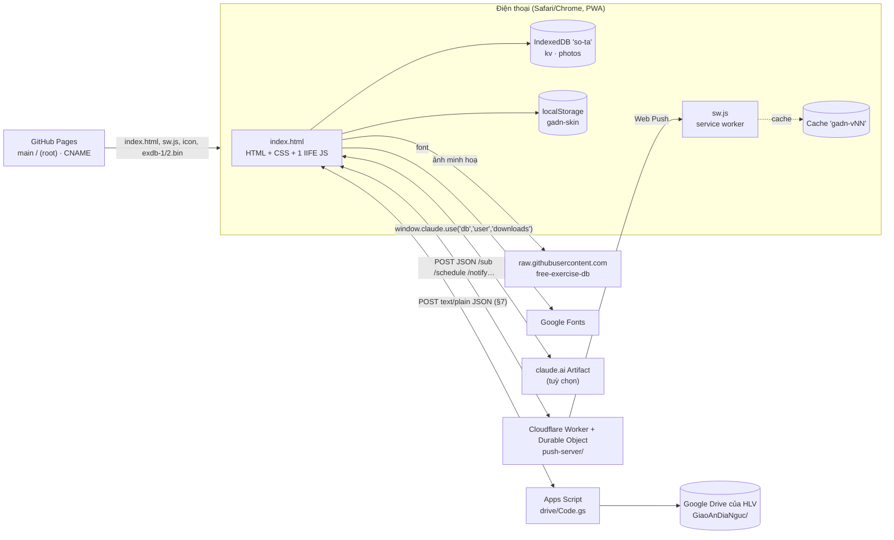

# SA tổng — Kiến trúc giải pháp Giáo Án Địa Ngục

> Mô tả cách app trên `main` sau PA-22 (+ PA-15: tài liệu, test, dọn mã chết) được xây dựng. Yêu cầu nghiệp vụ: [BR.md](BR.md). Điểm chưa ổn kỹ thuật: [VAN-DE-VA-CHIEN-LUOC.md](VAN-DE-VA-CHIEN-LUOC.md).
> Không ghi số dòng `index.html:nnnn` nữa (file đổi liên tục, ~5.300 dòng): tìm theo tên hàm/khối bằng `grep`.

## 1. Tổng quan



- **Không có backend của nhà phát triển.** Toàn bộ logic app chạy trên trình duyệt; dữ liệu ở IndexedDB của máy. Hai máy chủ nhỏ **do HLV tự triển khai trên tài khoản của mình** (không bắt buộc): `drive/Code.gs` (đồng bộ + tài khoản, §7) và `push-server/` (thông báo đẩy, §7.6). Tuỳ chọn đồng bộ tài khoản Claude khi chạy trong Artifact (§10).
- **Phân phối**: GitHub Pages dựng từ `main` / `(root)`; tên miền riêng qua `CNAME`. Bản xem thử một nhánh: `https://raw.githack.com/hoangtourguide0507-create/giao-an-dia-nguc/<nhánh>/index.html`.
- **Không có bước build.** Sửa `index.html` là phát hành; tăng `CACHE` trong `sw.js` để máy người dùng nhận bản mới.

### Thành phần file

| File | Vai trò |
|---|---|
| `index.html` | Toàn bộ app (~5.340 dòng): `<style>` (2 giao diện `amber`/`gold`), HTML khung (header + chuông, `#view`, thanh nghỉ, thanh dưới `#nav-bar`, bảng `#sheet`, hộp báo `#alarm`, `#toast`), 2 thư viện nhúng (qrcode-generator 1.4.4 MIT, jsQR 1.4.0 Apache-2.0), script chính (IIFE `'use strict'`, thẻ `<script>` lớn nhất) |
| `sw.js` | Service worker: cache vỏ app, network-first cho trang, cache-first cho tài nguyên, font; hiện thông báo đẩy và mở lại app khi bấm thông báo |
| `drive/Code.gs`, `drive/appsscript.json`, `drive/HUONG-DAN-TRIEN-KHAI.md` | Máy chủ đồng bộ + tài khoản chạy trên Google Apps Script (§7) |
| `push-server/` (`src/index.js`, `wrangler.toml`, `HUONG-DAN.md`) | Máy chủ Web Push trên Cloudflare Workers (§7.6) |
| `thiet-ke/pa22-mockup.html` | Bản mockup thiết kế PA-22 (tham khảo, không phát hành vào app) |
| `.claude/agents/*.md` | Các agent làm việc của dự án (duyệt PA, kiểm chứng y khoa, kiểm thử, máy chủ, triển khai PA, UX/UI) |
| `manifest.webmanifest`, `icon-*.png`, `apple-touch-icon.png` | PWA |
| `exdb-1.bin`, `exdb-2.bin` | 2 gói hình minh hoạ offline (định dạng GAP1, §9) |
| `package.json`, `playwright.config.mjs`, `scripts/`, `tests/` | Hai bộ kiểm thử (§12), không phát hành cho người dùng |

## 2. Cấu trúc script chính

Script chính là một IIFE, chia thành các khối (tiêu đề `/* ---------- … ---------- */`):

| Khối | Vị trí | Nội dung chính |
|---|---|---|
| Tiện ích | đầu script | `$`, `$$`, `esc` (chống chèn HTML), `uid`, ngày `ymd/parseYmd/addDays/dm`, `num` (đọc số có dấu phẩy), `fmt` (vi-VN), `e1rm` (Epley), bộ icon theo skin, `renderNav` |
| Dữ liệu nền | sau tiện ích | `MUSCLES` (13 nhóm), `TYPES` (lower/upper/iso, nấc mặc định), `REST_MODES`, `TEMPOS`, ước lượng thời gian (`exEst`, `dayEst`, `remainEst`), `PAIN_AREAS/PAIN_LV`, `PACE`, thư viện bài `LIB2` (tên, vùng cơ, kiểu, mã hình, nhóm), `SAMPLE`, `METRICS`, `newEx`, `migrateEx` |
| Lưu trữ | `LDB`, `Cloud` | `LDB` (IndexedDB + bộ nhớ dự phòng), `Cloud` (claude.ai), `DB` (LDB + đẩy ảnh lên Cloud), `reconcile`, `connectCloud`, `switchProfile`, `freshState`, `loadState` (chuyển đổi dữ liệu cũ), `save` (trễ 300 ms) / `flush` |
| Truy vấn | sau `loadState` | `findDay/findEx/slotOf`, `exHistory`, `wt`, `bestE1`, `volOf`, `roundStep`, `baseKg`, `manualOverride`, xoay vòng `rotDue/rotPick/swapMain` |
| Chu kỳ & gợi ý | `cycleInfo`… | `cycleInfo` (tự dời `cycleStart` khi đã hết tuần deload, PA-28), `isDeload`, `suggestBase/suggestLinear/suggestDouble/suggestP/suggest`, `roadmap` |
| Giao diện chung | `ui`, `SKINS` | `ui` (trạng thái giao diện, không lưu), `SKINS` (`amber`, `gold`), `applySkin`, `NAV` + `renderNav`, `render`, hiệu ứng (`countUp`, `prSlam`), kéo để làm mới, `renderHeader` |
| Hồi phục & gợi ý buổi | `muscleLoad`… | `muscleLoad`, `readiness`, `rdState`, `recommend`, `dayWhy`, banner |
| Trang chủ & buổi tập | khối `viewHome`, `viewSession` | `viewHome` (thẻ vé buổi gợi ý `.hero.tix`, chip ngày `.dchip`, hai thẻ nhỏ `.g2`, `todoItems/todosHtml`, độ hồi phục), `startPickSheet` (nút Tập), `viewSession`, `entryCard/entryMini`, khởi động, drop set, `makeEntry`, `startSession`, vùng cơ (`ZONES`, `guessZone`), hướng dẫn (`guideSheet`, `bodyMap`, `CUES`), thư viện hình offline |
| Đồng hồ nghỉ & thông báo | khối `startRest` | `startRest/tickRest/stopRest`, `notifyRestEnd` (Notification API), `schedulePush/cancelPush` (hẹn giờ trên máy chủ thông báo), âm thanh WebAudio, rung, Wake Lock, `finishSummary`, `saveSession`, `reopenSession`; Web Push: `pushRegister`, `pushRules`, `pushNotify`, `drvTopic(s)`, `notifCardHtml` |
| Tab Lịch tập | khối `viewPlan` | `viewPlan` (biểu đồ nhỏ `svg.spk` trên thẻ bài khi ≥ 2 buổi), các bảng sửa bài/ngày/kho bài/tạ đơn/xoay vòng, nén ảnh `compressImage`, `hydratePhotos` |
| Tab Tiến độ | khối `viewWeek` | `periodStats`, `progTabs` (Sức mạnh / Cơ thể / Ảnh), `tonTix`, `viewWeek`, `progressSheet`, `sessionSheet`, biểu đồ SVG `drawLine` |
| Cơ thể & ảnh | khối `viewBody` | `bRange`, `bodyVerdict`, `viewBody`, ảnh trước/sau, đọc EXIF (hiển thị trong Tiến độ) |
| Tab Tài khoản | khối `viewMore` | `viewMore` (thẻ hồ sơ + danh mục `row()` → trang con `SEC[...]`: drive, backup, pack, pace, form, height, notif, skin, install, wipe) |
| Người tập & HLV | khối `profStats` | `profStats`, `withState`, `coachData/coachRich`, `viewCoach`, kế hoạch tuần (`wpBuild`, `weekPlanSheet`), các bảng hồ sơ |
| Đồng bộ, Drive, tài khoản | khối `DRV` … `acc*` | Động cơ gộp dùng chung (`syncPack`, `cleanPkg`, `syncMerge`, `syncApply`, `syncUndo`, `syncReceive` cho file `gadn-sync`); Drive: `DRV`, `drvCall`, `drvSyncOne`, `drvEnsureAll`, `drvAuto/drvSoon`, ảnh (`drvLocalPhotos/drvPushPhotos/drvPullPhotos`), mã liên kết `drvCode/drvLinkReceive`; tài khoản: `accCardHtml`, `accApply`, `accRoster`, `accTvSheet/accTvForm`, `accHet`; QR: `qrScanSheet`, `decodeQrImage`, `joinQrParts`, `handleCodeText`, `oldCode`, `copyOrShareCode`; khôi phục file 1 người |
| File, sheet, toast | cuối khối đồng bộ | `saveFile` (claude.ai downloads hoặc `<a download>`), `openSheet/closeSheet/confirmSheet`, `toast` |
| Sự kiện | khối `handlers` | Bảng `handlers` (~186 hành động), ủy quyền `click` theo `data-act`, `input` theo `data-bind`, `change` (file, checkbox), `keydown` Esc, `visibilitychange`, `pagehide`, `beforeinstallprompt`, đồng hồ 1 giây |
| Khởi động | cuối script | Mở IndexedDB → nạp hồ sơ + trạng thái → `render` → đọc trạng thái gói hình → `connectCloud` → `drvAuto` sau 0,8 s → `pushRegSoon` → tự mở kế hoạch tuần → đăng ký service worker (chỉ https) |

`window.__sota` lộ một số hàm thuần (`suggest`, `roadmap`, `exHistory`, `baseKg`, `warmSets`, `recommend`, `muscleLoad`, `switchProfile`, `findEx`, `slotOf`, `autoGid`, `guideSheet`, `exdbMatch`) và getter `state/ui/profiles` để gỡ lỗi và kiểm thử.

### Mô hình hiển thị
- `render()` vẽ lại toàn bộ `#view` bằng chuỗi HTML theo `ui.tab` (`viewHome`/`viewSession` — `viewToday` chọn một trong hai —, `viewPlan`, `viewWeek` (kèm Cơ thể/Ảnh qua `progTabs`), `viewMore`, `viewCoach`); trong buổi tập dùng `refreshExCard(i)` để chỉ thay một thẻ bài (giữ con trỏ ô ghi chú).
- Mọi nút có `data-act="<tên>"` → `handlers[<tên>](element, event)`. Ô nhập có `data-bind` (`set`, `note`, `setting`, `cmp`).
- Bảng nổi (`openSheet(html)`) dùng cho mọi form/hộp thoại; `confirmSheet` cho xác nhận nguy hiểm (`pendingConfirm`).
- Mọi chuỗi người dùng nhập được `esc()` trước khi chèn vào HTML.

## 3. Mô hình dữ liệu

### 3.1 Nơi lưu

| Nơi | Khoá | Giá trị |
|---|---|---|
| IndexedDB `so-ta` v1, store `kv` | `profiles` | `{ active, list: [{ id, name, color, goal? }], coach?: { on, name, dismiss } }` |
| | `state` (hồ sơ `p1`), `state:<pid>` | Trạng thái một hồ sơ (§3.2) |
| | `exdbPack` | `{ n, at }` — đã tải thư viện hình |
| | `drvUp:<link máy chủ>` | Danh sách mã băm ảnh đã đẩy lên Drive (≤ 3.000) |
| | `pushRegH` | Băm lần đăng ký thông báo gần nhất (tránh đăng ký lặp) |
| | `syncUndo` | `{ pid, prev, photos, at }` — bản trước lần gộp/khôi phục gần nhất |
| IndexedDB store `photos` | `<uid>` | Ảnh máy tập / ảnh body: data URL JPEG nén |
| | `exdb:<gid>:<0\|1>` | Hình minh hoạ (JPEG nén từ GitHub, hoặc WebP từ gói offline) |
| | `vid:<uid>` | Video của tôi (Blob). Dọn bằng `vidIdsOf` khi xoá hồ sơ/ngày/bài; "Xoá toàn bộ dữ liệu" xoá mọi khoá trừ `exdb:*` (PA-28) |
| localStorage | `gadn-skin` | Giao diện đang dùng `amber`/`gold` (để tô màu trước khi IndexedDB mở) |
| claude.ai db | `data/users/<uid>/profiles` | Bản sao `profiles` |
| | `data/users/<uid>/app` (p1) · `app-<pid>` | Trạng thái hồ sơ trừ `sessions` |
| | `…/sessions/<id>` · `…/photos/<id>` | Từng buổi tập · từng ảnh `{ d }` |

### 3.2 Trạng thái một hồ sơ (`v: 3`)

```js
{
  v: 3, updatedAt,                       // ms, đặt mỗi lần save()
  days: [Day], sessions: [Session], active: Session|null,
  body: [{ id, date, weight?, bodyFat?, muscle?, waist?, visceral?, restHR?, hrv?, ... }],
  bodyPhotos: [{ id, date, t, pose: 'Trước'|'Nghiêng'|'Sau', photoId }],
  pains: [{ id, area, level: 1|2|3, since, note, resolvedAt }],
  weekPlans: { 'YYYY-MM-DD(thứ Hai)': { mode: 'balanced'|'focus'|'deload', focus, dec: {exId: 'ok'|'hold'|'custom'}, custom: {exId: kg}, kg: {exId: kg}, at } },
  wpSkip: 'YYYY-MM-DD',                  // tuần đã bấm "Để sau"
  coachLink: { pk, name },               // (cũ) liên kết HLV kiểu mã; Drive dùng `drv`
  drv: { id, m, u, n, hvSeen, hlvSeen, hvRev, hlvRev, sentH, at, nP, nS, restore }, // liên kết Drive của hồ sơ (§7.2)
  syncMark: { sent: {sessionId: rev}, planH, at }, syncDel: { s: {id: t}, e: {key: t} },
  settings: { name, height, sex, setMin: 10, setMax: 20, deloadEvery: 6, cycleStart, progMode: 'linear'|'double',
              pace: 'std'|'slow', restMode, tempo, formCues, skin: 'amber'|'gold', skin22, mig29, notify, sfx, haptics, eff, fxOff, animOff,
              acc: { vai: 'hlv'|'hv', u, ten, hlv? },          // tài khoản đăng nhập (§7.3)
              drvUrl, drvKey, drvSv,                           // máy HLV: link máy chủ + MÃ HLV; drvSv = link nhớ ở màn đăng nhập
              pushServer, nRemind, nDays[], nTime, nWeekly, nDrive,   // thông báo (§7.6)
              lastBackupAt, lastBackupSess, backupSkipAt, packSkip, sets3, warmAll,
              /* còn trong dữ liệu nhưng không dùng: */ schedule, remindTime, remindBefore, restAlert, alertMethod, ntfyTopic, pushKey, shortcutName, alertV17 }
}
```

- **Cài đặt dùng chung}
```

- **Cài đặt dùng chung mọi hồ sơ** (`GLOBAL_KEYS`): giao diện, âm thanh/rung/hiệu ứng, thông báo (`notify, pushServer, nRemind, nDays, nTime, nWeekly, nDrive`), Drive/tài khoản (`drvUrl, drvKey, drvSv, acc`), sao lưu (`lastBackupAt, lastBackupSess, backupSkipAt`) và các khoá cũ (`alertMethod, ntfyTopic, pushKey, restAlert, shortcutName, alertV17`) — được chép từ hồ sơ cũ sang hồ sơ mới khi chuyển người / nạp từ tài khoản / khôi phục.
- **Day** `{ id, name, exercises: [Exercise], sample? }`.
- **Exercise** (bài chính) `{ id, name, muscle, zone, type, sets, repTarget, repMin, repMax, dropSet, step, rest, restV: 2, setup, photos[], currentKg, targetKg, kgSetAt, warmup, each, gid, cues, vid, vlink, slot, mainSince, alts: [Exercise không có alts/slot/mainSince], srcId?, alias?, fromStudent? }`. `rest = 0` = tự động theo nhịp nghỉ. `kgSetAt` ≠ null nghĩa là mức tạ được nhập tay (ưu tiên hơn lịch sử cũ hơn).
- **Session** `{ id, dayId ('custom'|'qr'|'sync'|day.id), dayName, date, startedAt, finishedAt, paused, deload, est, focus, reopened, entries: [Entry], syncFrom?, fromQR? }`.
- **Entry** `{ exId, name, muscle, note, each, sets: [{ kg, reps, dr?: 1..3, ef?: 'e'|'m'|'h'|'f' }], drop: {kg, reps}|null /* kiểu cũ */ }`. Trong buổi đang tập set còn có `done`, `m` (set drop đã tự sửa) và `entry.warm[]`, `entry.manual`.

### 3.3 Chuyển đổi dữ liệu cũ (`loadState`, `migrateEx`, `index.html:1798`)
Gộp với `freshState()`; bổ sung trường thiếu; `rest === OLD_REST[type]` → 0; `sets3` (mọi bài 3 set, 1 lần), `warmAll` (bật khởi động, 1 lần); `alertV17`/`alertMethod` cũ → thông báo của app (bỏ Phím tắt); giao diện: skin lạ → `amber`; chưa có cờ `skin22` và hồ sơ đã có giáo án/buổi tập (dữ liệu cũ) → `amber`; hồ sơ trống giữ lựa chọn; luôn đặt `skin22` (VD-32 đã sửa, PA-26). `deloadBanner` chịu được `cycleInfo()` null (VD-31, PA-26); mảng/đối tượng hỏng → rỗng; `mainSince` = ngày buổi đầu có bài; sau mỗi `render` còn `fillZones` (đoán vùng cơ, sửa nhóm "Khác") và `fillGids` (đoán hình minh hoạ). Test: `tests/app/misc.spec.mjs`.
Gộp với `freshState()`; bổ sung trường thiếu; `rest === OLD_REST[type]` → 0; `sets3` (mọi bài 3 set, 1 lần), `warmAll` (bật khởi động, 1 lần); `mig29` (PA-29: `pace: 'slow'` → `'std'`, `progMode: 'double'` → `'linear'`, đặt cờ; cũng chạy trong `normState` nên gói đồng bộ cũ không mang lại giá trị cũ); `alertV17`/`alertMethod` cũ → thông báo của app (bỏ Phím tắt); giao diện: nếu chưa có cờ `skin22` hoặc skin lạ → `amber` rồi đặt `skin22` (nguồn gốc VD-32); mảng/đối tượng hỏng → rỗng; `mainSince` = ngày buổi đầu có bài; sau mỗi `render` còn `fillZones` (đoán vùng cơ, sửa nhóm "Khác") và `fillGids` (đoán hình minh hoạ). Test: `tests/app/misc.spec.mjs`.

## 4. Thuật toán

### 4.1 Gợi ý mức tạ (`suggest`, `index.html:1868–1955`)
```
suggest(ex) = áp kế hoạch tuần đã duyệt( thêm "kg/tay"( suggestP(ex) ) )
suggestP    = điều chỉnh theo đau( suggestBase(ex) )   (tuần deload + đau: tính 80% trên `base` = mức gốc W, không trên 90% — PA-29)
suggestBase = chưa có lịch sử hoặc mức tự nhập mới hơn → start/new
              tuần deload → 90% W
              progMode 'double' → suggestDouble, ngược lại suggestLinear
```
- Lịch sử = `exHistory(ex.id)` bỏ buổi `deload`, mới nhất trước; `W = max kg` buổi gần nhất.
- Linear: điều kiện "đạt", "hỏng" (`ef === 'f'`), "dễ" (mọi set `ef === 'e'`), cổng 6 ngày tính từ buổi đầu tiên liên tiếp ở W (`gate = first.date + 6`), `need` theo `PACE`. Giảm: `roundStep(W*0.9)` hoặc `W − step`.
- Đau: `low = floor(kg × 0,8 / step) × step`. Kế hoạch tuần: thay `kg` bằng `weekPlans[thứ Hai].kg[exId]`, nhãn theo `dec`.
- `roundStep(v, step) = max(0, round(v/step) × step)` (2 chữ số thập phân).

### 4.2 Lộ trình (`roadmap`) — mô phỏng tối đa 156 tuần từ mức hiện tại: tuần không deload tăng `streak`, đủ `need` thì +1 nấc; tuần deload `(w0 + i − 1) % (every + 1) + 1 === every + 1` lấy 90%; dừng khi đủ số tuần hiển thị và đã đạt mục tiêu.

### 4.3 Khởi động, drop set
- `warmSets(ex, W, kind)` (§BR-03.6), loại trùng và loại ≥ W; dự phòng 1 set.
- `dropKgs(ex, base)`: 80/65/50% làm tròn theo nấc, mỗi set < set trước ít nhất 1 nấc; `syncDrops` tính lại set drop chưa tập, chưa sửa (`m`).

### 4.4 Hồi phục & gợi ý buổi
- `muscleLoad()`: thời điểm gần nhất mỗi nhóm cơ có ≥ 2 set (gồm drop). `readiness = min(1, giờ đã qua / (72|48))`.
- `recommend()`: với mỗi ngày tập, trọng số theo số set mỗi nhóm cơ: `score = 0,6·rd + 0,25·need + 0,15·stale − 0,5·[rd<0,66] − 0,6·pf` (need = phần set còn thiếu so với `setMin` của tuần, stale = min(1, ngày từ lần cuối/7), pf = tỉ lệ set của bài đang đau mức ≥ 2).
- Nhóm cơ chính của ngày (`dayRd`) = nhóm chiếm ≥ 30% số set.

### 4.5 Khác
- Thời gian dự kiến: `setSec(r) = r × tempo + 5`; `SWITCH_SEC 60`, `WARM_SEC 170`, `FEEL_SEC 60` (§BR-06.7). Còn lại trong buổi: `remainEst`.
- Khối lượng: `Σ kg × rep` (+ drop), × 2 nếu tạ đơn ghi mỗi tay. Kỷ lục: `bestE1 > max lịch sử + 0,01`.
- Cơ thể: `fatKg = weight × bodyFat/100`, `leanKg = weight − fatKg`; mốc so sánh `refOf` = lần đo cuối của tháng trước, không có thì lần đầu; ngưỡng 0,3 kg.
- Vùng cơ: `ZONES` (12 nhóm lớn → vùng), `ZRULES` (regex theo tên tiếng Việt/Anh), `LIBZ` từ thư viện.
- Tìm hình minh hoạ: `exdbMatch` dịch từ khoá Việt → Anh (`VI_EN`), so khớp token với 870+ bài Free Exercise DB (`EXDB` nhúng); tự gán khi điểm ≥ 0,75.

## 5. Luồng buổi tập

```mermaid
stateDiagram-v2
  [*] --> ChuaTap: không có state.active
  ChuaTap --> DangTap: startSession(day | exIds) → state.active
  DangTap --> DangTap: set-done → startRest(); step/input → save(); add/rm/swap entry
  DangTap --> TongKet: finish → finishSummary()
  TongKet --> DangTap: Tập tiếp
  TongKet --> DaLuu: saveSession() → sessions.push, currentKg, cycleStart
  DangTap --> ChuaTap: cancel / discardSession
  DaLuu --> DangTap: reopenSession (trong ngày hoặc ≤ 6 giờ)
```


- `syncActive()` giữ buổi đang tập khớp giáo án khi sửa giáo án (thay bài chính đổi, bỏ bài đã xoá chưa tập, thêm bài mới, sắp lại thứ tự; nhóm ưu tiên lên đầu).
- Đồng hồ nghỉ: `rest.end` (ms) + `setInterval(250ms)`; hết giờ khi trang ẩn thì đặt `rest.pending`, `visibilitychange` hiện hộp báo. Lúc bắt đầu nghỉ gọi `schedulePush` (hẹn giờ trên máy chủ thông báo nếu có), hết giờ khi trang ẩn gọi `notifyRestEnd` (§7.6).

## 6. Lưu trữ & đồng bộ tài khoản Claude

- `save()` đặt `updatedAt`, ghi IndexedDB sau 300 ms (`flush`), `Cloud.sync()` sau 1,2 s. Trang ẩn/`pagehide` → ghi ngay.
- `Cloud.pushNow()` so JSON với bản đã gửi (`lastMain`, `lastSess`) — chỉ ghi phần đổi; xoá buổi không còn. Hàng đợi tuần tự `Cloud.q`; lỗi → `Cloud.fail` đổi trạng thái (`readonly` với `invalid_argument/not_granted/revoked/capability_*/transform_error`, `full` với `quota_exceeded`, còn lại `retry`).
- `reconcile(local)`: tài khoản mới hơn hoặc bằng (`updatedAt`) → nạp tài khoản (giữ cài đặt dùng chung); ngược lại thêm buổi chỉ có trên tài khoản rồi đẩy lên; lần đầu (tài khoản trống) đẩy cả ảnh.
- **Quy tắc xung đột = cả khối mới hơn thắng** (xem VD-13).

## 7. Đồng bộ qua Google Drive, tài khoản, thông báo

### 7.1 Máy chủ Apps Script (`drive/Code.gs`, `PHIEN_BAN = 3`)
- Triển khai thành *Ứng dụng web* (chạy dưới quyền HLV, truy cập "Bất kỳ ai"); app gọi `fetch(POST, Content-Type: text/plain;charset=utf-8, body JSON)` để tránh preflight CORS, theo chuyển hướng, hết hạn 45 s (`drvCall`). Trả `{ ok, … }` hoặc `{ ok:false, loi }`; `xungDot:true` khi bản đã đổi (app thử lại một lần với `rev` mới).
- Dữ liệu trong thư mục Drive `GiaoAnDiaNguc/`: `thanh-vien.json` (danh sách học viên; mã bí mật chỉ lưu dạng băm), `hoc-vien/<id>/hv.json` (phần học viên gửi lên) và `hlv.json` (phần HLV gửi xuống), `anh/<mã băm>` (ảnh máy tập dùng chung, không trùng), `sao-luu/YYYY-MM-DD/` (tự sao lưu mỗi đêm, giữ 14 ngày). Properties: `THU_MUC_ID`, `MA_HLV` (32 ký tự), `HLV_TK`.
- Giới hạn: ảnh ≤ 3 MB, gói gửi ≤ 25 MB, tải ảnh về ≤ ~20 MB/lần; `LockService` bao quanh ghi.
- Hành động (`a`): `ping` · `dn` (đăng nhập) · `hlv.tao` · `tv.them` · `tv.tk` · `tv.ds` · `tv.doima` · `tv.tat` / `tv.bat` · `dx` (đăng xuất) · `mk.doi` · `keo` (kéo, kèm `biet:{hv,hlv}` = số bản đã biết) · `day` (đẩy `goi`, kèm `vai`, `rev`) · `anh.co` / `anh.day` / `anh.lay` (hỏi/đẩy/lấy ảnh theo mã băm).
- Quyền: HLV dùng **MÃ HLV** hoặc phiên HLV; học viên dùng **mã bí mật của mình** (từ mã liên kết) hoặc phiên đăng nhập; mỗi tài khoản tối đa 8 phiên.
- Hàm chạy tay trong Apps Script: `caiDat` (tạo thư mục, MÃ HLV, lịch sao lưu), `xemMaHLV`, `doiMaHLV`, `xoaTaiKhoanHLV`.

### 7.2 Liên kết và vòng đồng bộ trong app
- Mỗi hồ sơ có `state.drv = { id, m, … }` (`id` học viên trên Drive, `m` mã bí mật). Máy HLV dùng `drvCred` = (`drvUrl`, `drvKey`); máy học viên dùng (`drv.u`, `drv.m`) hoặc phiên đăng nhập.
- `drvAuto(force)` (khi mở app, khi quay lại app, `drvSoon` = 20 s sau lần lưu; ≥ 15 s giữa hai lần; hoãn khi có bảng mở): máy HLV `drvEnsureAll` (mọi hồ sơ chưa có `drv` thì `tv.them`), rồi `drvSyncOne(pid)` cho từng hồ sơ; không đồng bộ khi hồ sơ đang tập (`active`).
- `drvSyncOne`: `keo` → nếu phía kia có bản mới (`rev` > đã thấy) thì `cleanPkg` → kéo ảnh thiếu (`drvPullPhotos`, tối đa 6 vòng) → `syncMerge` → ghi; sau đó đóng gói `syncPack` đầy đủ, so băm với `sentH`; khác thì `drvPushPhotos` (hỏi `anh.co`, đẩy lô ≤ 4 MB `anh.day`) rồi `day`. Máy HLV mới (`drv.restore`) hoặc HLV dùng 2 máy (bản `hlv.json` mới hơn) thì gộp bản HLV từ Drive trước khi gửi.
- Mã liên kết `GAL1.<id>.<i>.<n>.<thân base64url>` (`drvCode`): thân chứa link máy chủ, id, mã bí mật, tên, địa chỉ máy chủ thông báo; chia nhiều mã QR khi dài. `drvLinkReceive` xem trước rồi `drv-link`. Từ chối nếu dán vào máy HLV hoặc đang tập dở.
- Đọc mã: `handleCodeText` (regex `GA[QSPL][12]\.…` rồi `joinQrParts`), camera `qrScanSheet` (jsQR), ảnh `receiveQrImage`. **Mọi kiểu mã khác `GAL1` → `oldCode()`**.
- **Mã băm ảnh (PA-25)**: `strHash` = `<base36>_<độ dài base36>` (khớp `reMaAnh_` của `Code.gs`: `[A-Za-z0-9_-]{4,64}`). Bản trước dùng dấu `.` nên `anh.day` bị từ chối (VD-33). `normHash` đổi mã cũ → mới bằng `replace('.', '_')` (cùng nội dung thì cùng mã); áp ở `cleanEx` (`ph`), `cleanPkg` (khoá `photos`) và danh sách ảnh đã gửi `drvUp:<url>` (`drvPushPhotos`, ghi lại khi có mã cũ). Mã ảnh nội bộ trong IndexedDB (`photos`) là `uid()`, không phải mã băm nên không cần đổi; `sentH` cũ lệch một lần → gửi lại một lần rồi ổn định.

### 7.3 Tài khoản
- `acc-hlv-go` → `hlv.tao` (cần MÃ HLV) rồi `dn`; `acc-login` → `dn` (tên đăng nhập + mật khẩu) trả `{ vai, ma (phiên), id, ten, hlv… }`; `accApply` gắn phiên: HLV (`drvUrl/drvKey/acc`, bật `coach`, `accRoster(login)` tạo hồ sơ cho từng học viên trên Drive, bỏ hồ sơ trống) hoặc học viên (tìm/tạo hồ sơ có `drv.id` đúng).
- Mật khẩu: băm có muối phía máy chủ; sai 8 lần liền khoá 15 phút; tên đăng nhập 3–30 ký tự `[a-z0-9._-]`; mật khẩu ≥ 6 ký tự. `accHet()` nhận biết phiên bị thu hồi qua nội dung lỗi (thu hồi / hết hạn / cần đăng nhập lại) → giữ dữ liệu, dừng đồng bộ, hiện *Đăng nhập lại*.
- Quản lý học viên: `tv.ds`, `tv.them`, `tv.tk` (cấp/đặt lại), `tv.tat/bat` (khoá/mở), `tv.doima` (mã mới); `acc-copy` gửi thông tin đăng nhập qua `copyOrShareCode`.

### 7.4 Gói đồng bộ và động cơ gộp (dùng chung cho Drive và file)
- Gói đầy đủ (`syncPack`): `{ app:'gadn-sync', v, role:'coach'|'student', link:{pk, cn}, name, at, plan|null, sessions[], del:{s,e}, photos? }`. Khoá nhận diện bài dùng chung giữa máy: `shKey(id) = '~' + 5 ký tự FNV-1a`, `canonKey = shKey(srcId || id)`, `exKeys` gồm cả `alias`.
- Nhận: `cleanPkg` giới hạn mọi trường (≤ 2.000 buổi, ≤ 60 bài/buổi, ≤ 30 set, ảnh chỉ nhận data URL jpeg/png/webp < 1,5 MB, ≤ 300 ảnh) → `syncMerge(L0, P, choices)` chạy trên **bản sao**, trả báo cáo `R` → Drive ghi thẳng; file thủ công xem trước rồi `syncApply` (ghi + lưu `syncUndo`).
- `syncMerge`: (1) gộp dấu xoá; (2) giáo án — máy HLV giữ cấu trúc, nhận mức tạ (`kgSetAt` mới hơn), ảnh (theo băm nội dung), bài `fs` (học viên tự thêm); máy học viên dựng lại theo HLV, khớp bài theo khoá rồi theo tên (ghi `alias`), bỏ bài HLV đã bỏ; (3) buổi tập theo id, so `rev = finishedAt||startedAt`, xử lý buổi trùng; (4) mức tạ theo buổi mới nhất; (5) cập nhật `syncMark`, `coachLink`.
- Đã xoá khỏi mã (PA-19 + dọn PA-15): mã giáo án `SOTA1/SOTA2`, mã gọn `GAS1/GAS2`, `GAQ1`, `GAP2`; các kiểu này chỉ còn được **nhận diện** để báo `oldCode()`. File `gadn-sync` vẫn nhận qua *Khôi phục từ file* (`restore-file` → `syncReceive`).

### 7.5 QR & ảnh mã
- Vẽ: `qrcode(0, 'L')` lên canvas (mã liên kết `GAL1` của HLV); ảnh mã: canvas trắng, tiêu đề + hướng dẫn, các mã xếp dọc → PNG.
- Đọc camera: `getUserMedia` (camera sau, 1920×1080), cắt vùng giữa 85%, luân phiên 960/480 px, `jsQR` mỗi 90 ms, gom trang theo `id`; mã lạ (không phải mã app) → tiếp tục chờ.
- Đọc ảnh: thử cả ảnh, rồi trượt khung vuông bằng chiều ngang ảnh từ trên xuống (bước 6%), `inversionAttempts: 'attemptBoth'`.

### 7.6 Thông báo
- **Cục bộ**: `notifyRestEnd` khi hết giờ nghỉ mà trang ẩn: `serviceWorker.getRegistration().showNotification` (dự phòng `new Notification`), `tag:'rest'`. Xin quyền ở `notif-allow`.
- **Web Push qua `push-server/`** (Cloudflare Worker + Durable Object `Hub`, SQLite): khoá VAPID tự sinh lần chạy đầu. API JSON: `GET /vapid`; `POST /sub {sub, topics, tzOff}`, `/schedule {sub, at, title, body, tag}`, `/cancel {sub, tag}`, `/remind {sub, rules[{dow, hm, title, body, tag}], tzOff}`, `/notify {topic, title, body, tag, from}`, `/test {sub}`. Giới hạn 3.000 máy, 20 luật nhắc, 200 chủ đề mỗi máy.
- Địa chỉ máy chủ: `pushBase() = settings.pushServer || PUSH_SERVER` (`PUSH_SERVER` dựng sẵn từ PA-23). Khi khởi động, nếu đã bật `notify`, chưa có đăng ký đẩy, có máy chủ và quyền = granted thì `enablePush()` tự nối; `notif-allow` cũng gọi `enablePush()` ngay sau khi được cấp quyền.
- App: `pushRegister` (đăng ký `PushManager` bằng khoá VAPID, gửi `/sub` + `/remind`; băm `pushRegH` tránh lặp; gọi lại sau khi đổi cài đặt/đăng nhập) · `schedulePush/cancelPush` (giờ nghỉ) · `pushNotify` khi giáo án HLV đổi hoặc học viên tập xong · **chủ đề** `drvTopic = SHA-256(mã:id:phía)[:32]` nên chỉ hai máy cùng liên kết nhận được tin của nhau.
- `sw.js` hiện thông báo trong sự kiện `push` và mở/focus app ở `notificationclick`.

## 8. File sao lưu
```js
// cả máy
{ app:'so-ta', v:3, exportedAt, profiles, states: { <pid>: State }, state /* hồ sơ đang xem */, photos: { <id>: dataURL } }
// 1 người
{ app:'so-ta', v:3, one:true, exportedAt, person:{ id, name, color }, state, photos }
```
Khôi phục cả máy xoá ảnh cũ không còn dùng, ghi ảnh trong file, ghi trạng thái từng hồ sơ; khôi phục 1 người chỉ đụng một hồ sơ, lọc ảnh bằng `okPhoto`, lưu `syncUndo`. Lưu file: `navigator.share({files})` nếu được (không áp dụng trong claude.ai), không thì `saveFile` (`window.claude.use('downloads')` hoặc thẻ `<a download>`).

## 9. Offline & tài nguyên ngoài
- `sw.js` (`CACHE = 'gadn-v53'`): `install` thêm `SHELL` (bỏ qua file lỗi) + `skipWaiting`; `activate` xoá cache khác tên + `clients.claim`; `fetch`: GET cùng nguồn — bỏ qua `.bin`; điều hướng = network-first, lưu `./index.html`, lỗi mạng trả bản lưu; còn lại cache-first rồi lưu. Font Google: trả bản lưu ngay + làm mới ngầm. `notificationclick`, `push` (hiện thông báo từ máy chủ thông báo). Service worker chỉ đăng ký khi `https:` và `<html data-pwa="1">`.
- **Gói hình GAP1** (`exdb-1.bin`, `exdb-2.bin`): `"GAP1"` + `uint32 LE` độ dài chỉ mục + chỉ mục JSON `[[key, offset, length]]` + dữ liệu WebP. Tải từ cùng nguồn, dự phòng `https://hoangtourguide0507-create.github.io/giao-an-dia-nguc/`, đọc luồng để báo tiến độ, ghi từng hình `exdb:<key>` vào IndexedDB, xin `navigator.storage.persist()`.
- Hình lẻ: `https://raw.githubusercontent.com/yuhonas/free-exercise-db/main/exercises/<gid>/<0|1>.jpg` → nén → lưu IndexedDB.
- Video YouTube: chỉ mở trang tìm kiếm (`<tên tiếng Anh> exercise proper form`), không nhúng.

## 10. Chạy trong claude.ai
`inArtifact = typeof window.claude.use === 'function'` (chờ tối đa 2 s). `Cloud.init` cần `use('db')`, `use('user')`, `user.id()`; kiểm tra `user.can('data.write')`. Khác biệt hành vi: xem BR-18.6. Lưu ý: ảnh (cả ảnh body) được đẩy lên tài khoản (VD-12).

## 11. Bảo mật & riêng tư
- Chèn HTML luôn qua `esc()`; link video riêng chỉ mở khi bắt đầu `http(s)://`; `rel="noopener"`.
- Dữ liệu nhận từ máy khác được làm sạch (§7.2, `decodePlan`), ảnh chỉ nhận data URL ảnh.
- Dữ liệu chỉ rời máy tới: Google Drive/Apps Script **của chính HLV** (khi đã liên kết), máy chủ thông báo Cloudflare **của HLV** (chỉ tiêu đề/nội dung thông báo, thời điểm hẹn, endpoint đẩy, chủ đề băm), tải hình từ GitHub, font Google, và (tuỳ chọn) tài khoản Claude.
- Mật khẩu không lưu trên máy (chỉ phiên); máy chủ lưu mật khẩu dạng băm có muối, mã bí mật dạng băm. Link máy chủ Apps Script mở "Bất kỳ ai" nên mọi thao tác đều đòi MÃ HLV / phiên / mã học viên.
- Khôi phục file cả máy chưa làm sạch nội dung trạng thái (dựa vào `esc()` khi hiển thị) — VD-25.

## 12. Kiến trúc kiểm thử

Có **hai bộ kiểm thử bổ trợ nhau**, cả hai chạy trên cùng `index.html`.

### 12.1 Bộ Playwright/Node (`npm test`) — đo coverage, bộ chính
```
tests/
  helpers/
    fixtures.mjs   – fixture Playwright: đồng hồ giả (21/10/2026 09:00 +07), chặn mạng ngoài (font rỗng,
                     ảnh GitHub = JPEG 1×1), phục vụ index.html đã gắn bộ đếm Istanbul; lớp App (seed IndexedDB,
                     click theo data-act, tab()/more() đi theo thanh dưới mới, startPick, đọc state/ui/profiles/idb,
                     flushed); fixture gas (máy chủ Drive thật, §12.3) và device (thêm máy thứ hai/ba có dữ liệu riêng)
    coverage.mjs   – gắn bộ đếm (istanbul-lib-instrument), lưu window.__coverage__ mỗi lần chụp, gộp, báo cáo, chặn ngưỡng
    data.mjs       – dựng dữ liệu mẫu đúng định dạng app (ex, day, session, state, basicPlan, jpegWithExif…)
    calc.mjs       – chạy hàm thuần của app (window.__sota) trên trạng thái dựng sẵn
    cloud.mjs      – giả lập window.claude (db/user/downloads) lưu trong sessionStorage
    notify.mjs     – giả lập Notification, PushManager, service worker và máy chủ thông báo
  app/*.spec.mjs   – 21 file theo BR (dòng đầu mỗi file ghi mã BR)
  sw/sw.test.mjs   – test sw.js bằng node:test trong vm với self/caches/fetch giả
scripts/
  serve.mjs        – máy chủ tĩnh cho test
  check-syntax.mjs – node --check script chính + sw.js
  uncovered.mjs    – liệt kê dòng còn nhiều nhánh chưa chạy
  dead-code.py     – tìm hàm/khai báo/handler không có đường chạy tới (mã chết), dùng khi dọn mã
```
- **Môi trường**: Chromium headless, iPhone 13 (cảm ứng, 390×844), `vi-VN`, `Asia/Ho_Chi_Minh`, quyền clipboard. Đồng hồ cài bằng `page.clock.install` và vẫn chạy thật; test đồng hồ nghỉ dùng `clock.fastForward`.
- **Gieo dữ liệu**: `App.seed()` chụp coverage → sang trang tĩnh cùng nguồn (để app không ghi đè) → ghi thẳng IndexedDB → mở lại app. Trước khi `reload()` phải `flushed()` vì `save()` trễ 300 ms.
- **Coverage**: chụp `window.__coverage__` trước mỗi lần tải lại trang và khi test kết thúc → `coverage/raw/*.json` → `globalTeardown` gộp, in tóm tắt, tạo `coverage/report/` (HTML, lcov, json-summary) và `coverage/summary.txt`, **ném lỗi nếu dưới ngưỡng** (lines/statements/functions 90%, branches 80%).
- **Chống coverage farm**: không `istanbul ignore`; mã chết bị xoá (đã dọn hai đợt) thay vì phủ; test đi qua nút/luồng người dùng thật và khẳng định kết quả (dữ liệu trong IndexedDB, chữ trên màn hình, thông báo), không gọi hàm chỉ để chạy dòng.
- **Lỗi đã biết**: 3 `test.fixme` — VD-02 (nút "Gửi giáo án"), VD-31 (duyệt kế hoạch tuần Deload lỗi vẽ lại), VD-32 (giao diện Đen Tuyền không nhớ). Cổng thử đọc từ biến môi trường `PORT` (mặc định 4173) để chạy song song nhiều bản sao repo.
- **Lỗi đã biết**: 2 `test.fixme` — VD-02 (nút "Gửi giáo án"), VD-33 (ảnh máy tập qua Drive). VD-31, VD-32 đã sửa ở PA-26.
- **Lỗi đã biết**: 3 `test.fixme` — VD-31 (duyệt kế hoạch tuần Deload lỗi vẽ lại), VD-32 (giao diện Đen Tuyền không nhớ), VD-33 (ảnh máy tập qua Drive).

### 12.2 Bộ Python/Playwright của dự án (`bash tests/chay.sh`) — hồi quy theo PA
Các file `tests/test_<pa>.py` (`sync form focus pa10 pa11 pa14 pa16 pa18 pa19 pa20 pa21 pa22`) cộng `tests/test_push_server.mjs` và `tests/test_drive_gas.js`. `chuan_bi.py` chép `index.html` sang `tests/site/` và chèn `window.__ev = eval` để các test chạy lệnh trong phạm vi IIFE. Chạy được bằng Python Playwright (`pip install playwright && playwright install chromium`). Bộ này **không đo coverage**; vai trò là giữ nguyên các hành vi PA trước đã chốt. Test của tính năng đã bỏ (báo cáo tháng, Phím tắt, gửi giáo án bằng mã) đã được cắt khỏi các file này khi gộp PA-15 với PA-22.

### 12.3 Máy chủ thật trong test
`tests/gas_server.js` nạp **chính `drive/Code.gs`** vào `vm` với Drive/Properties/Lock/Utilities giả lập trong bộ nhớ, mở cổng HTTP và in `MA_HLV` ra stdout. Fixture `gas` chuyển yêu cầu tới `https://script.google.com/**` về máy chủ này, nên test đồng bộ/đăng nhập chạy qua đúng mã máy chủ (kể cả đặt lại mật khẩu, khoá, phiên hết hạn). Mỗi test một máy chủ riêng; fixture `device` mở thêm máy học viên với dữ liệu riêng.

### 12.4 Kết quả (22/10/2026)
- `npm test`: **177 test app xanh + 4 `fixme`**, 7 test `sw.js` xanh (script `check` cú pháp OK).
- Coverage script chính `index.html`: **lines 98,99% · statements 92,54% · functions 95,54% · branches 80,39%**; `sw.js` 100% dòng.
- `bash tests/chay.sh`: 12 file Python (gồm `pa23`) + push-server + Code.gs đều đạt.

### Bản đồ BR → test

| BR | File test |
|---|---|
| BR-01 Khởi đầu | `onboarding.spec.mjs` |
| BR-02 Giáo án | `plan.spec.mjs`, `misc.spec.mjs`, `edge.spec.mjs` |
| BR-03 Buổi tập | `session.spec.mjs`, `misc.spec.mjs`, `edge.spec.mjs` |
| BR-04 Đồng hồ nghỉ | `rest.spec.mjs`, `notify.spec.mjs` |
| BR-05 Gợi ý mức tạ | `suggest.spec.mjs` |
| BR-06 Trang chủ | `home.spec.mjs` |
| BR-07 Kế hoạch tuần | `weekplan.spec.mjs` |
| BR-08 Đau | `pain.spec.mjs` |
| BR-09 Tiến độ — Sức mạnh | `progress.spec.mjs` |
| BR-10 Cơ thể & ảnh | `body.spec.mjs` |
| BR-11 Tài khoản & cài đặt | `settings.spec.mjs`, `misc.spec.mjs` |
| BR-12 Người tập & HLV | `profiles.spec.mjs` |
| BR-13 Gửi/nhận giáo án (đã bỏ) | `drive.spec.mjs`, `edge.spec.mjs` |
| BR-14 Đồng bộ Drive | `drive.spec.mjs`, `syncfile.spec.mjs`, `test_drive_gas.js` |
| BR-15 Sao lưu | `backup.spec.mjs` |
| BR-16 Hướng dẫn | `guide.spec.mjs` |
| BR-17 Báo cáo tháng (đã bỏ) | — |
| BR-18 claude.ai | `cloud.spec.mjs` |
| BR-19 Offline | `tests/sw/sw.test.mjs` |
| BR-20 Dữ liệu cũ | `misc.spec.mjs` |
| BR-21 Tài khoản đăng nhập | `account.spec.mjs`, `drive.spec.mjs` |
| BR-22 Thông báo | `notify.spec.mjs`, `test_push_server.mjs` |
| BR-23 Chia sẻ kết quả với PT | `share.spec.mjs`, `session.spec.mjs` |

## 13. Chia sẻ kết quả buổi tập với PT (PA-32)
Mã: `shEncode` / `shDecode`, `shareSheet`, `shareReceive`, `shareApply`, `shMerge`, `ensureUids`, `shareHash` (`index.html`, khối PA-32 trước khối PA-21).
- **Gói nhị phân** (không JSON): byte đầu = `SH_VER` (1) + 128 nếu phần sau đã nén `deflate-raw` (chỉ nén khi ngắn hơn). Phần thân: `uid` (chuỗi), tên học viên (chuỗi), ngày (số ngày từ 01/01/2020, varint), số buổi (≤ 6); mỗi buổi: phút trong ngày (bắt đầu), phút tập, cờ deload, tên buổi, số bài (≤ 40); mỗi bài: **byte chỉ số kho bài** (`LIB2`, 255 = bài tự đặt tên, sau đó gửi tên), **mã đồng bộ** (`canonKey`, 5 ký tự, rỗng nếu không có), ghi chú, rồi các **nhóm set**: `[số lần][kg × 10 varint][rep varint][byte cờ: bit 0–1 dr, bit 2–4 ef (e/m/h/f), bit 5 drop]`. Chuỗi là varint độ dài + UTF-8.
- **Chuỗi lặp**: set giống hệt (kg, rep, dr, ef, drop) liên tiếp gộp thành một nhóm.
- **Link**: `location.origin + location.pathname + '#cs=' + mã` (base64url, `b64u`/`unb64u`). Fragment không gửi lên máy chủ.
- **Quy tắc với `LIB2`**: chỉ số kho bài là vị trí trong `LIB2`. **Chỉ được thêm bài vào cuối `LIB2`**, không chèn/xoá/đổi chỗ, nếu không link cũ sai tên bài.
- **userid**: `profiles.list[].uid`, gán bởi `ensureUids()` một lần (ưu tiên `state.drv.id`, rồi mã hồ sơ khác `p1`, rồi `uid()`). Không đổi `id` nội bộ.
- **Gửi**: `shareSheet(date, sid?)` lọc buổi của ngày (hoặc một buổi), dựng link, vẽ QR bằng `drawQR`; "Gửi link" dùng `copyOrShareCode`; "Gửi ảnh QR" dùng `navigator.share` với file PNG, không có thì tải về.
- **Nhận**: `shareHash()` (khi khởi động và `hashchange`), `qrScanSheet` (camera: nhận ngay khi giải được link), `receiveQrImage` (ảnh tải lên), `handleCodeText` (dán). Mọi đường đi đều gọi `shareReceive(token)`: giải mã (kiểm phiên bản, số buổi/bài/set), bật `profiles.coach` (on), tìm hồ sơ cùng `uid`, mở bảng xem trước.
- **Ghi (`shareApply`)**: không ghi khi hồ sơ đang có `state.active`. Chụp `prev`, dựng `ns` từ bản sao rồi `shMerge(ns, d)`: ghi dấu xoá (`syncDelOf(ns).s`) cho buổi cũ cùng ngày, thêm buổi mới (`shSession`: khớp bài theo `exKeys`/tên, bài kho chưa có thì `shAddPlan` vào ngày cùng tên buổi), cập nhật `currentKg` khi không có buổi nào mới hơn của bài. Ghi vào `state` (hồ sơ đang mở) hoặc `LDB.put('kv', stateKey(pid), ns)`. `ui.shareUndo` giữ `prev` và `prevUid` để **Hoàn tác** (`shareUndo`).
- **Gợi ý sau lưu buổi**: `saveSession` → `shareAskSheet(a)` khi không phải chế độ HLV và `settings.shareNoAsk` chưa bật; checkbox `#share-noask` đặt cờ đó.
- **Lịch**: ô ngày trong `.mcal` mở `daySheet(date)` (danh sách buổi + chia sẻ cả ngày).
- **Dữ liệu cũ & đồng bộ**: `uid` là trường thêm mới trong `profiles.list`, hồ sơ cũ được gán khi chia sẻ/nhận lần đầu. Gói Drive và sao lưu không đổi định dạng. Buổi nhận không có mã buổi gốc nên được cấp mã `sh…` mới.
- **Offline**: không tài nguyên mới; `CACHE` đã tăng lên `gadn-v55`.
- **Riêng tư**: ai có link/QR đều xem được buổi tập và tên học viên của ngày đó.

## 14. Phát hành
1. Làm trên nhánh `pa-<số>-<tên>`; `npm run check` + `npm test` xanh; tăng `CACHE` trong `sw.js`.
2. Gửi link raw.githack để xem thử; chờ "Duyệt PA-x".
3. `git merge --no-ff` vào `main` → GitHub Pages tự dựng → thêm dòng mốc `vN` (SHA trên `main`) vào [ADR 0001](adr/0001-bo-nhanh-moc.md).
4. Máy chủ Drive/thông báo do HLV tự triển khai (`drive/HUONG-DAN-TRIEN-KHAI.md`, `push-server/HUONG-DAN.md`): sửa `Code.gs` thì dán lại và *Triển khai → Phiên bản mới* (URL giữ nguyên).
5. Số phiên bản hiển thị trong app cập nhật thủ công, không gắn với `CACHE` (VD-26).
