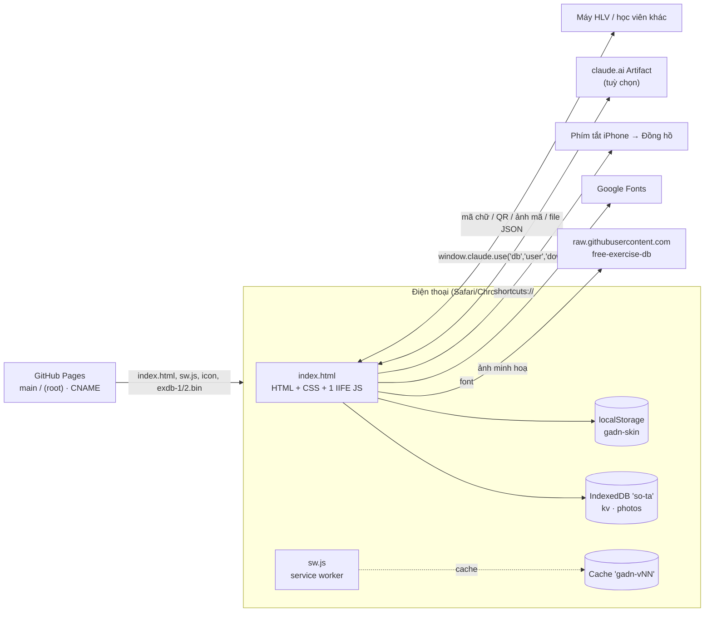

# SA tổng — Kiến trúc giải pháp Giáo Án Địa Ngục

> Mô tả cách app trên `main` (+ PA-15) được xây dựng. Yêu cầu nghiệp vụ: [BR.md](BR.md). Điểm chưa ổn kỹ thuật: [VAN-DE-VA-CHIEN-LUOC.md](VAN-DE-VA-CHIEN-LUOC.md).
> Số dòng `index.html:nnnn` ghi theo bản PA-15 (5.284 dòng) — dùng để tìm nhanh, có thể lệch khi file đổi.

## 1. Tổng quan



- **Không có backend.** Toàn bộ logic chạy trên trình duyệt. Dữ liệu ở IndexedDB của máy; tuỳ chọn đồng bộ với tài khoản Claude khi chạy trong Artifact.
- **Phân phối**: GitHub Pages dựng từ `main` / `(root)`; tên miền riêng qua `CNAME`. Bản xem thử một nhánh: `https://raw.githack.com/hoangtourguide0507-create/giao-an-dia-nguc/<nhánh>/index.html`.
- **Không có bước build.** Sửa `index.html` là phát hành; tăng `CACHE` trong `sw.js` để máy người dùng nhận bản mới.

### Thành phần file

| File | Vai trò |
|---|---|
| `index.html` | Toàn bộ app: `<style>` (~1.300 dòng, 4 skin), HTML khung (header, `#view`, thanh nghỉ, thanh tab, bảng `#sheet`, trình xem `#viewer`, hộp báo `#alarm`, `#toast`), 2 thư viện nhúng (qrcode-generator 1.4.4 MIT, jsQR 1.4.0 Apache-2.0), script chính (IIFE `'use strict'`, ~3.950 dòng, `index.html:1348–5281`) |
| `sw.js` | Service worker: cache vỏ app, network-first cho trang, cache-first cho tài nguyên, font; thông báo |
| `manifest.webmanifest`, `icon-*.png`, `apple-touch-icon.png` | PWA |
| `exdb-1.bin`, `exdb-2.bin` | 2 gói hình minh hoạ offline (định dạng GAP1, §9) |
| `package.json`, `playwright.config.mjs`, `scripts/`, `tests/` | Bộ kiểm thử (§12), không phát hành cho người dùng |

## 2. Cấu trúc script chính

Script chính là một IIFE, chia thành các khối (tiêu đề `/* ---------- … ---------- */`):

| Khối | Vị trí | Nội dung chính |
|---|---|---|
| Tiện ích | `:1352` | `$`, `$$`, `esc` (chống chèn HTML), `uid`, ngày `ymd/parseYmd/addDays/dm`, `num` (đọc số có dấu phẩy), `fmt` (vi-VN), `e1rm` (Epley), bộ icon theo skin, `renderNav` |
| Dữ liệu nền | `:1496` | `MUSCLES` (13 nhóm), `TYPES` (lower/upper/iso, nấc mặc định), `REST_MODES`, `TEMPOS`, ước lượng thời gian (`exEst`, `dayEst`, `remainEst`), `PAIN_AREAS/PAIN_LV`, `PACE`, thư viện bài `LIB2` (tên, vùng cơ, kiểu, mã hình, nhóm), `SAMPLE`, `METRICS`, `newEx`, `migrateEx` |
| Lưu trữ | `:1618` | `LDB` (IndexedDB + bộ nhớ dự phòng), `Cloud` (claude.ai), `DB` (LDB + đẩy ảnh lên Cloud), `reconcile`, `connectCloud`, `switchProfile`, `freshState`, `loadState` (chuyển đổi dữ liệu cũ), `save` (trễ 300 ms) / `flush` |
| Truy vấn | `:1813` | `findDay/findEx/slotOf`, `exHistory`, `wt`, `bestE1`, `volOf`, `roundStep`, `baseKg`, `manualOverride`, xoay vòng `rotDue/rotPick/swapMain` |
| Chu kỳ & gợi ý | `:1854–1970` | `cycleInfo`, `isDeload`, `suggestBase/suggestLinear/suggestDouble/suggestP/suggest`, `roadmap` |
| Giao diện chung | `:1971` | `ui` (trạng thái giao diện, không lưu), `SKINS`, `applySkin`, `render`, hiệu ứng (`countUp`, `prSlam`), kéo để làm mới, `renderHeader` |
| Hồi phục & gợi ý buổi | `:2097` | `muscleLoad`, `readiness`, `rdState`, `recommend`, `dayWhy`, banner |
| Tab Tập | `:2163` | `viewToday`, `viewSession`, `entryCard/entryMini`, khởi động, drop set, `makeEntry`, `startSession`, vùng cơ (`ZONES`, `guessZone`), hướng dẫn (`guideSheet`, `bodyMap`, `CUES`), thư viện hình offline |
| Đồng hồ nghỉ | `:2817` | `startRest/tickRest/stopRest`, Phím tắt, âm thanh WebAudio, rung, Wake Lock, `finishSummary`, `saveSession`, `reopenSession` |
| Tab Giáo án | `:2953` | `viewPlan`, các bảng sửa bài/ngày/kho bài/tạ đơn/xoay vòng, nén ảnh `compressImage`, `hydratePhotos` |
| Tab Tiến độ | `:3201` | `periodStats`, báo cáo tháng (`reportData`, `reportImage` vẽ canvas, `reportCsv`), `viewWeek`, `progressSheet`, `sessionSheet`, biểu đồ SVG `drawLine` |
| Tab Cơ thể | `:3515` | `bRange`, `bodyVerdict`, `viewBody`, ảnh trước/sau, đọc EXIF |
| Tab Tôi | `:3749` | `viewMore`, `diagRows` |
| Người tập & HLV | `:3814` | `profStats`, `withState`, `coachData/coachRich`, `viewCoach`, kế hoạch tuần (`wpBuild`, `weekPlanSheet`), nhận GAQ1 cũ, các bảng hồ sơ |
| Chia sẻ & đồng bộ | `:4134–4694` | Mã giáo án, đồng bộ hai chiều (`syncPack`, `cleanPkg`, `syncMerge`, `syncApply`, `syncUndo`), ảnh mã QR, đọc ảnh mã, dán mã, khôi phục file 1 người, mã gọn (`cExEnc/cExDec`, `syncCompact/syncExpand`, `syncPackQR`) |
| File, sheet, toast | `:4695–4725` | `saveFile` (claude.ai downloads hoặc `<a download>`), `openSheet/closeSheet/confirmSheet`, `toast` |
| Sự kiện | `:4726` | Bảng `handlers` (176 hành động), ủy quyền `click` theo `data-act`, `input` theo `data-bind`, `change` (file, checkbox), `keydown` Esc, `visibilitychange`, `pagehide`, `beforeinstallprompt`, đồng hồ 1 giây |
| Khởi động | `:5264` | Mở IndexedDB → nạp hồ sơ + trạng thái → `render` → đọc trạng thái gói hình → `connectCloud` → tự mở kế hoạch tuần → xử lý `#nhap=` → đăng ký service worker (chỉ https) |

`window.__sota` lộ một số hàm thuần (`suggest`, `roadmap`, `exHistory`, `baseKg`, `warmSets`, `recommend`, `muscleLoad`, `decodePlan`, `findEx`, `slotOf`, `autoGid`, `exdbMatch`…) và getter `state/ui/profiles` để gỡ lỗi và kiểm thử.

### Mô hình hiển thị
- `render()` vẽ lại toàn bộ `#view` bằng chuỗi HTML theo `ui.tab` (`viewToday/viewPlan/viewWeek/viewBody/viewMore/viewCoach`); trong buổi tập dùng `refreshExCard(i)` để chỉ thay một thẻ bài (giữ con trỏ ô ghi chú).
- Mọi nút có `data-act="<tên>"` → `handlers[<tên>](element, event)`. Ô nhập có `data-bind` (`set`, `note`, `setting`, `cmp`).
- Bảng nổi (`openSheet(html)`) dùng cho mọi form/hộp thoại; `confirmSheet` cho xác nhận nguy hiểm (`pendingConfirm`).
- Mọi chuỗi người dùng nhập được `esc()` trước khi chèn vào HTML.

## 3. Mô hình dữ liệu

### 3.1 Nơi lưu

| Nơi | Khoá | Giá trị |
|---|---|---|
| IndexedDB `so-ta` v1, store `kv` | `profiles` | `{ active, list: [{ id, name, color, goal? }], coach?: { on, name, dismiss } }` |
| | `state` (hồ sơ `p1`), `state:<pid>` | Trạng thái một hồ sơ (§3.2) |
| | `exdbPack` | `{ n, at }` — đã tải thư viện hình |
| | `syncUndo` | `{ pid, prev, photos, at }` — bản trước lần gộp/khôi phục gần nhất |
| IndexedDB store `photos` | `<uid>` | Ảnh máy tập / ảnh body: data URL JPEG nén |
| | `exdb:<gid>:<0\|1>` | Hình minh hoạ (JPEG nén từ GitHub, hoặc WebP từ gói offline) |
| | `vid:<uid>` | Video của tôi (Blob) |
| localStorage | `gadn-skin` | Skin đang dùng (để tô màu trước khi IndexedDB mở) |
| claude.ai db | `data/users/<uid>/profiles` | Bản sao `profiles` |
| | `data/users/<uid>/app` (p1) · `app-<pid>` | Trạng thái hồ sơ trừ `sessions` |
| | `…/sessions/<id>` · `…/photos/<id>` | Từng buổi tập · từng ảnh `{ d }` |

### 3.2 Trạng thái một hồ sơ (`v: 3`)

```js
{
  v: 3, updatedAt,                       // ms, đặt mỗi lần save()
  days: [Day], sessions: [Session], active: Session|null,
  body: [{ id, date, weight?, bodyFat?, muscle?, waist?, visceral?, restHR?, hrv?, ... }],
  bodyPhotos: [{ id, date, t, pose: 'Trước'|'Nghiêng'|'Sau', photoId }],
  pains: [{ id, area, level: 1|2|3, since, note, resolvedAt }],
  weekPlans: { 'YYYY-MM-DD(thứ Hai)': { mode: 'balanced'|'focus'|'deload', focus, dec: {exId: 'ok'|'hold'|'custom'}, custom: {exId: kg}, kg: {exId: kg}, at } },
  wpSkip: 'YYYY-MM-DD',                  // tuần đã bấm "Để sau"
  coachLink: { pk, name },               // máy học viên: hồ sơ này liên kết HLV nào
  syncMark: { sent: {sessionId: rev}, planH, at }, syncDel: { s: {id: t}, e: {key: t} },
  qrSent: [sessionId],                   // GAQ1 cũ
  settings: { name, height, sex, setMin: 10, setMax: 20, deloadEvery: 6, cycleStart, progMode: 'linear'|'double',
              pace: 'std'|'slow', restMode, tempo, formCues, skin, notify, shortcutName, sfx, haptics, eff, fxOff, animOff,
              lastBackupAt, lastBackupSess, backupSkipAt, packSkip, sets3, warmAll, alertV17,
              /* còn trong dữ liệu nhưng không dùng: */ schedule, remindTime, remindBefore, restAlert, alertMethod, ntfyTopic, pushServer, pushKey }
}
```

- **Cài đặt dùng chung mọi hồ sơ** (`GLOBAL_KEYS`): `skin, notify, alertMethod, ntfyTopic, pushServer, pushKey, restAlert, shortcutName, alertV17, sfx, haptics, eff, fxOff, animOff, lastBackupAt, lastBackupSess, backupSkipAt` — được chép từ hồ sơ cũ sang hồ sơ mới khi chuyển người / nạp từ tài khoản / khôi phục.
- **Day** `{ id, name, exercises: [Exercise], sample? }`.
- **Exercise** (bài chính) `{ id, name, muscle, zone, type, sets, repTarget, repMin, repMax, dropSet, step, rest, restV: 2, setup, photos[], currentKg, targetKg, kgSetAt, warmup, each, gid, cues, vid, vlink, slot, mainSince, alts: [Exercise không có alts/slot/mainSince], srcId?, alias?, fromStudent? }`. `rest = 0` = tự động theo nhịp nghỉ. `kgSetAt` ≠ null nghĩa là mức tạ được nhập tay (ưu tiên hơn lịch sử cũ hơn).
- **Session** `{ id, dayId ('custom'|'qr'|'sync'|day.id), dayName, date, startedAt, finishedAt, paused, deload, est, focus, reopened, entries: [Entry], syncFrom?, fromQR? }`.
- **Entry** `{ exId, name, muscle, note, each, sets: [{ kg, reps, dr?: 1..3, ef?: 'e'|'m'|'h'|'f' }], drop: {kg, reps}|null /* kiểu cũ */ }`. Trong buổi đang tập set còn có `done`, `m` (set drop đã tự sửa) và `entry.warm[]`, `entry.manual`.

### 3.3 Chuyển đổi dữ liệu cũ (`loadState`, `migrateEx`, `index.html:1798`)
Gộp với `freshState()`; bổ sung trường thiếu; `rest === OLD_REST[type]` → 0; `sets3` (mọi bài 3 set, 1 lần), `warmAll` (bật khởi động, 1 lần); `alertV17` → cách báo `shortcut`; skin cũ → `gold`; mảng/đối tượng hỏng → rỗng; `mainSince` = ngày buổi đầu có bài; sau mỗi `render` còn `fillZones` (đoán vùng cơ, sửa nhóm "Khác") và `fillGids` (đoán hình minh hoạ). Test: `tests/app/misc.spec.mjs`.

## 4. Thuật toán

### 4.1 Gợi ý mức tạ (`suggest`, `index.html:1868–1955`)
```
suggest(ex) = áp kế hoạch tuần đã duyệt( thêm "kg/tay"( suggestP(ex) ) )
suggestP    = điều chỉnh theo đau( suggestBase(ex) )
suggestBase = chưa có lịch sử hoặc mức tự nhập mới hơn → start/new
              tuần deload → 90% W
              progMode 'double' → suggestDouble, ngược lại suggestLinear
```
- Lịch sử = `exHistory(ex.id)` bỏ buổi `deload`, mới nhất trước; `W = max kg` buổi gần nhất.
- Linear: điều kiện "đạt", "hỏng" (`ef === 'f'`), "dễ" (mọi set `ef === 'e'`), cổng 6 ngày tính từ buổi đầu tiên liên tiếp ở W (`gate = first.date + 6`), `need` theo `PACE`. Giảm: `roundStep(W*0.9)` hoặc `W − step`.
- Đau: `low = floor(kg × 0,8 / step) × step`. Kế hoạch tuần: thay `kg` bằng `weekPlans[thứ Hai].kg[exId]`, nhãn theo `dec`.
- `roundStep(v, step) = max(0, round(v/step) × step)` (2 chữ số thập phân).

### 4.2 Lộ trình (`roadmap`) — mô phỏng tối đa 156 tuần từ mức hiện tại: tuần không deload tăng `streak`, đủ `need` thì +1 nấc; tuần deload `(w0 + i − 1) % (every + 1) + 1 === every + 1` lấy 90%; dừng khi đủ số tuần hiển thị và đã đạt mục tiêu.

### 4.3 Khởi động, drop set
- `warmSets(ex, W, kind)` (§BR-03.6), loại trùng và loại ≥ W; dự phòng 1 set.
- `dropKgs(ex, base)`: 80/65/50% làm tròn theo nấc, mỗi set < set trước ít nhất 1 nấc; `syncDrops` tính lại set drop chưa tập, chưa sửa (`m`).

### 4.4 Hồi phục & gợi ý buổi
- `muscleLoad()`: thời điểm gần nhất mỗi nhóm cơ có ≥ 2 set (gồm drop). `readiness = min(1, giờ đã qua / (72|48))`.
- `recommend()`: với mỗi ngày tập, trọng số theo số set mỗi nhóm cơ: `score = 0,6·rd + 0,25·need + 0,15·stale − 0,5·[rd<0,66] − 0,6·pf` (need = phần set còn thiếu so với `setMin` của tuần, stale = min(1, ngày từ lần cuối/7), pf = tỉ lệ set của bài đang đau mức ≥ 2).
- Nhóm cơ chính của ngày (`dayRd`) = nhóm chiếm ≥ 30% số set.

### 4.5 Khác
- Thời gian dự kiến: `setSec(r) = r × tempo + 5`; `SWITCH_SEC 60`, `WARM_SEC 170`, `FEEL_SEC 60` (§BR-06.7). Còn lại trong buổi: `remainEst`.
- Khối lượng: `Σ kg × rep` (+ drop), × 2 nếu tạ đơn ghi mỗi tay. Kỷ lục: `bestE1 > max lịch sử + 0,01`.
- Cơ thể: `fatKg = weight × bodyFat/100`, `leanKg = weight − fatKg`; mốc so sánh `refOf` = lần đo cuối của tháng trước, không có thì lần đầu; ngưỡng 0,3 kg.
- Vùng cơ: `ZONES` (12 nhóm lớn → vùng), `ZRULES` (regex theo tên tiếng Việt/Anh), `LIBZ` từ thư viện.
- Tìm hình minh hoạ: `exdbMatch` dịch từ khoá Việt → Anh (`VI_EN`), so khớp token với 870+ bài Free Exercise DB (`EXDB` nhúng); tự gán khi điểm ≥ 0,75.

## 5. Luồng buổi tập

```mermaid
stateDiagram-v2
  [*] --> ChuaTap: không có state.active
  ChuaTap --> DangTap: startSession(day | exIds) → state.active
  DangTap --> DangTap: set-done → startRest(); step/input → save(); add/rm/swap entry
  DangTap --> TongKet: finish → finishSummary()
  TongKet --> DangTap: Tập tiếp
  TongKet --> DaLuu: saveSession() → sessions.push, currentKg, cycleStart
  DangTap --> ChuaTap: cancel / discardSession
  DaLuu --> DangTap: reopenSession (trong ngày hoặc ≤ 6 giờ)
```


- `syncActive()` giữ buổi đang tập khớp giáo án khi sửa giáo án (thay bài chính đổi, bỏ bài đã xoá chưa tập, thêm bài mới, sắp lại thứ tự; nhóm ưu tiên lên đầu).
- Đồng hồ nghỉ: `rest.end` (ms) + `setInterval(250ms)`; hết giờ khi trang ẩn thì đặt `rest.pending`, `visibilitychange` hiện hộp báo. Phím tắt: `location.href = shortcuts://run-shortcut?...` lúc bắt đầu nghỉ.

## 6. Lưu trữ & đồng bộ tài khoản Claude

- `save()` đặt `updatedAt`, ghi IndexedDB sau 300 ms (`flush`), `Cloud.sync()` sau 1,2 s. Trang ẩn/`pagehide` → ghi ngay.
- `Cloud.pushNow()` so JSON với bản đã gửi (`lastMain`, `lastSess`) — chỉ ghi phần đổi; xoá buổi không còn. Hàng đợi tuần tự `Cloud.q`; lỗi → `Cloud.fail` đổi trạng thái (`readonly` với `invalid_argument/not_granted/revoked/capability_*/transform_error`, `full` với `quota_exceeded`, còn lại `retry`).
- `reconcile(local)`: tài khoản mới hơn hoặc bằng (`updatedAt`) → nạp tài khoản (giữ cài đặt dùng chung); ngược lại thêm buổi chỉ có trên tài khoản rồi đẩy lên; lần đầu (tài khoản trống) đẩy cả ảnh.
- **Quy tắc xung đột = cả khối mới hơn thắng** (xem VD-13).

## 7. Mã chia sẻ & đồng bộ giữa máy

### 7.1 Giáo án
| Tiền tố | Nội dung | Ghi chú |
|---|---|---|
| `SOTA1.` / `SOTA1z.` | JSON `{v:2, p?, q?, d:[{n, e:[{n,m,t,s,g,a,b,d,k,r,u,h,c?,i?,o,l}]}]}`, base64url, `z` = deflate-raw | Cũ, chỉ đọc. `c` mức tạ HLV đặt, `p/q` liên kết HLV |
| `SOTA2.` / `SOTA2z.` | `{v:3, d:[[tên, [bài gọn]]]}` — bài gọn `cExEnc`: `n` = tên hoặc `#xxxx` (băm 4 ký tự của tên trong thư viện), chỉ ghi trường khác mặc định `newEx(name)` | Đang dùng khi gửi |
| `GAP2.<id>.<i>.<n>.<thân>` | Bọc mã giáo án để chia nhiều mã QR | ≤ 900 ký tự/mã (`QR_MAX`) |

Giải mã luôn qua `decodePlan` → làm sạch (`clamp`) → xem trước → `import-apply` (thêm ngày mới) hoặc `planUpdateApply` (chuyển thành gói đồng bộ vai HLV rồi `syncMerge`, có hoàn tác).

### 7.2 Gói đồng bộ
- Gói đầy đủ (`syncPack`): `{ app:'gadn-sync', v, role:'coach'|'student', link:{pk, cn}, name, at, plan|null, sessions[], del:{s,e}, photos? }`. Khoá nhận diện bài dùng chung giữa máy: `shKey(id) = '~' + 5 ký tự FNV-1a`, `canonKey = shKey(srcId || id)`, `exKeys` gồm cả `alias`.
- Mã gọn `GAS2.<id>.<i>.<n>.<z|p><base64url>` (`syncCompact`): vai `r`, liên kết `k/q`, buổi dạng mảng `[id, date, startedAt(s), thời lượng(s), dayName, deload, paused(s), entries]`, set dẹt `[kg, rep, …]`, chỉ số set drop, chuỗi cảm giác `emhf-`; xoá `x/y`. `syncPackQR` chọn **nhiều buổi mới nhất vừa 1 mã** (tìm nhị phân); giáo án quá dài → lượt chỉ gửi giáo án, chia `QR_MAX − 40`.
- Cũ: `GAS1` (JSON gói đầy đủ), `GAQ1` (chỉ buổi tập, `{v:1,k,n,s:[…]}`), JSON thuần `gadn-sync` (dán hoặc file).
- Nhận: `cleanPkg` giới hạn mọi trường (≤ 2.000 buổi, ≤ 60 bài/buổi, ≤ 30 set, ảnh chỉ nhận data URL jpeg/png/webp < 1,5 MB, ≤ 300 ảnh) → `syncMerge(L0, P, choices)` chạy trên **bản sao**, trả báo cáo `R` để xem trước → `syncApply` ghi + lưu `syncUndo`.
- `syncMerge`: (1) gộp dấu xoá; (2) giáo án — máy HLV giữ cấu trúc, nhận mức tạ (`kgSetAt` mới hơn), ảnh (theo băm nội dung), bài `fs` (học viên tự thêm); máy học viên dựng lại theo HLV, khớp bài theo khoá rồi theo tên (ghi `alias`), bỏ bài HLV đã bỏ; (3) buổi tập theo id, so `rev = finishedAt||startedAt`, xử lý buổi trùng; (4) mức tạ theo buổi mới nhất; (5) cập nhật `syncMark`, `coachLink`.
- Ghép trang mã: `joinQrParts` (regex `^(GA[QSP][12])\.([a-z0-9]+)\.(\d+)\.(\d+)\.(.*)$`, lấy nhóm nhiều trang nhất). **Bộ quét camera dùng `split('.')` nên hỏng với thân có dấu chấm (VD-01).**

### 7.3 QR & ảnh mã
- Vẽ: `qrcode(0, 'L')` lên canvas (mỗi module 6 px, lề 4); ảnh mã `qrImage`: canvas trắng 1200 px, tiêu đề + hướng dẫn, các mã xếp dọc cách 360 px → PNG.
- Đọc camera: `getUserMedia` (camera sau, 1920×1080), cắt vùng giữa 85%, luân phiên 960/480 px, `jsQR` mỗi 90 ms, gom trang theo `id`.
- Đọc ảnh: thử cả ảnh, rồi trượt khung vuông bằng chiều ngang ảnh từ trên xuống (bước 6%), `inversionAttempts: 'attemptBoth'`.

## 8. File sao lưu
```js
// cả máy
{ app:'so-ta', v:3, exportedAt, profiles, states: { <pid>: State }, state /* hồ sơ đang xem */, photos: { <id>: dataURL } }
// 1 người
{ app:'so-ta', v:3, one:true, exportedAt, person:{ id, name, color }, state, photos }
```
Khôi phục cả máy xoá ảnh cũ không còn dùng, ghi ảnh trong file, ghi trạng thái từng hồ sơ; khôi phục 1 người chỉ đụng một hồ sơ, lọc ảnh bằng `okPhoto`, lưu `syncUndo`. Lưu file: `navigator.share({files})` nếu được (không áp dụng trong claude.ai), không thì `saveFile` (`window.claude.use('downloads')` hoặc thẻ `<a download>`).

## 9. Offline & tài nguyên ngoài
- `sw.js` (`CACHE = 'gadn-v44'`): `install` thêm `SHELL` (bỏ qua file lỗi) + `skipWaiting`; `activate` xoá cache khác tên + `clients.claim`; `fetch`: GET cùng nguồn — bỏ qua `.bin`; điều hướng = network-first, lưu `./index.html`, lỗi mạng trả bản lưu; còn lại cache-first rồi lưu. Font Google: trả bản lưu ngay + làm mới ngầm. `notificationclick`, `push` (giữ tương thích). Service worker chỉ đăng ký khi `https:` và `<html data-pwa="1">`.
- **Gói hình GAP1** (`exdb-1.bin`, `exdb-2.bin`): `"GAP1"` + `uint32 LE` độ dài chỉ mục + chỉ mục JSON `[[key, offset, length]]` + dữ liệu WebP. Tải từ cùng nguồn, dự phòng `https://hoangtourguide0507-create.github.io/giao-an-dia-nguc/`, đọc luồng để báo tiến độ, ghi từng hình `exdb:<key>` vào IndexedDB, xin `navigator.storage.persist()`.
- Hình lẻ: `https://raw.githubusercontent.com/yuhonas/free-exercise-db/main/exercises/<gid>/<0|1>.jpg` → nén → lưu IndexedDB.
- Video YouTube: chỉ mở trang tìm kiếm (`<tên tiếng Anh> exercise proper form`), không nhúng.

## 10. Chạy trong claude.ai
`inArtifact = typeof window.claude.use === 'function'` (chờ tối đa 2 s). `Cloud.init` cần `use('db')`, `use('user')`, `user.id()`; kiểm tra `user.can('data.write')`. Khác biệt hành vi: xem BR-18.6. Lưu ý: ảnh (cả ảnh body) được đẩy lên tài khoản (VD-12).

## 11. Bảo mật & riêng tư
- Chèn HTML luôn qua `esc()`; link video riêng chỉ mở khi bắt đầu `http(s)://`; `rel="noopener"`.
- Dữ liệu nhận từ máy khác được làm sạch (§7.2, `decodePlan`), ảnh chỉ nhận data URL ảnh.
- Không gửi dữ liệu đi đâu ngoài: tải hình từ GitHub, font Google, và (tuỳ chọn) tài khoản Claude. Chia sẻ giáo án không kèm mức tạ/lịch sử/ảnh.
- Khôi phục file cả máy chưa làm sạch nội dung trạng thái (dựa vào `esc()` khi hiển thị) — VD-25.

## 12. Kiến trúc kiểm thử

```
tests/
  helpers/
    fixtures.mjs   – fixture Playwright: đồng hồ giả (21/10/2026 09:00 +07), chặn mạng ngoài (font rỗng,
                     ảnh GitHub = JPEG 1×1), phục vụ index.html đã gắn bộ đếm Istanbul, lớp App (seed IndexedDB,
                     click theo data-act, đọc state/ui/profiles, navSpy cho shortcuts://), fakeCamera, sheetImage
    coverage.mjs   – gắn bộ đếm (istanbul-lib-instrument), lưu window.__coverage__ mỗi lần chụp, gộp, báo cáo, chặn ngưỡng
    data.mjs       – dựng dữ liệu mẫu đúng định dạng app (ex, day, session, state, basicPlan, jpegWithExif, sota1)
    calc.mjs       – chạy hàm thuần của app (window.__sota) trên trạng thái dựng sẵn
    cloud.mjs      – giả lập window.claude (db/user/downloads) lưu trong sessionStorage
  app/*.spec.mjs   – 20 nhóm test theo BR (dòng đầu mỗi file ghi mã BR)
  sw/sw.test.mjs   – test sw.js bằng node:test trong vm với self/caches/fetch giả
scripts/
  serve.mjs        – máy chủ tĩnh cho test
  check-syntax.mjs – node --check script chính + sw.js
  uncovered.mjs    – liệt kê dòng còn nhiều nhánh chưa chạy
```

- **Môi trường**: Chromium headless, thiết bị iPhone 13 (cảm ứng, 390×844), `vi-VN`, `Asia/Ho_Chi_Minh`, quyền clipboard. Đồng hồ cài bằng `page.clock.install` và vẫn chạy thật; test đồng hồ nghỉ dùng `clock.fastForward`.
- **Gieo dữ liệu**: `App.seed()` chụp coverage → sang trang tĩnh cùng nguồn (để app không ghi đè) → ghi thẳng IndexedDB → mở lại app.
- **Coverage**: chụp `window.__coverage__` trước mỗi lần tải lại trang và khi test kết thúc → `coverage/raw/*.json` → `globalTeardown` gộp, in tóm tắt, tạo `coverage/report/` (HTML, lcov, json-summary) và `coverage/summary.txt`, **ném lỗi nếu dưới ngưỡng** (lines/statements/functions 90%, branches 80%).
- **Lỗi đã biết**: `test.fixme` (2 test: VD-01, VD-02).
- Kết quả 21/10/2026: 161 test app xanh + 2 fixme, 7 test sw xanh; coverage script chính lines 98,99% · statements 93,16% · functions 95,73% · branches 80,27%; `sw.js` 100% dòng, 97,9% nhánh.

### Bản đồ BR → test

| BR | File test |
|---|---|
| BR-01 Khởi đầu | `onboarding.spec.mjs` |
| BR-02 Giáo án | `plan.spec.mjs`, `misc.spec.mjs`, `edge.spec.mjs` |
| BR-03 Buổi tập | `session.spec.mjs`, `misc.spec.mjs`, `edge.spec.mjs` |
| BR-04 Đồng hồ nghỉ | `rest.spec.mjs` |
| BR-05 Gợi ý mức tạ | `suggest.spec.mjs` |
| BR-06 Màn Tập | `today.spec.mjs` |
| BR-07 Kế hoạch tuần | `weekplan.spec.mjs` |
| BR-08 Đau | `pain.spec.mjs` |
| BR-09 Tiến độ | `progress.spec.mjs` |
| BR-10 Cơ thể | `body.spec.mjs` |
| BR-11 Cài đặt | `settings.spec.mjs` |
| BR-12 Người tập & HLV | `profiles.spec.mjs` |
| BR-13 Gửi/nhận giáo án | `share.spec.mjs` |
| BR-14 Đồng bộ | `sync.spec.mjs` |
| BR-15 Sao lưu | `backup.spec.mjs` |
| BR-16 Hướng dẫn | `guide.spec.mjs` |
| BR-17 Báo cáo tháng | `report.spec.mjs` |
| BR-18 claude.ai | `cloud.spec.mjs` |
| BR-19 Offline | `tests/sw/sw.test.mjs` |
| BR-20 Dữ liệu cũ | `misc.spec.mjs` |

## 13. Phát hành
1. Làm trên nhánh `pa-<số>-<tên>`; `npm run check` + `npm test` xanh; tăng `CACHE` trong `sw.js`.
2. Gửi link raw.githack để xem thử; chờ "Duyệt PA-x".
3. `git merge --no-ff` vào `main` → GitHub Pages tự dựng → tạo nhánh mốc `moc/v<số>`.
4. `APP_VERSION` (`index.html`, hiện `2026.10.19 · bản 29`) hiển thị ở chẩn đoán — cập nhật thủ công (VD-26).
